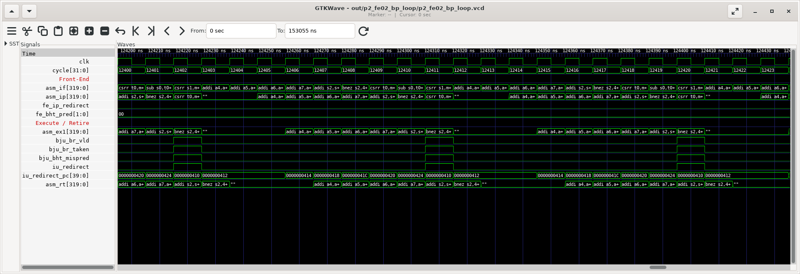
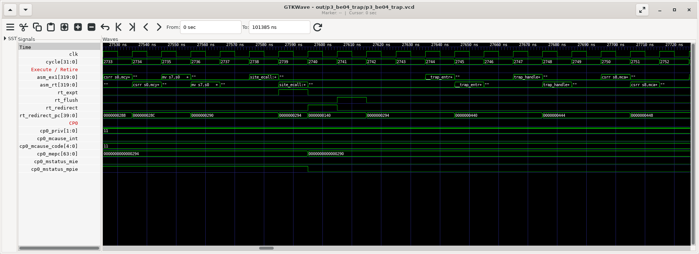
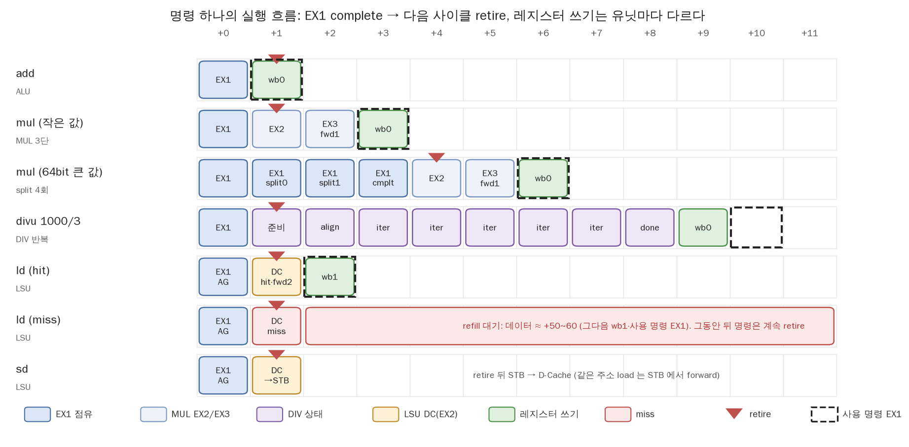
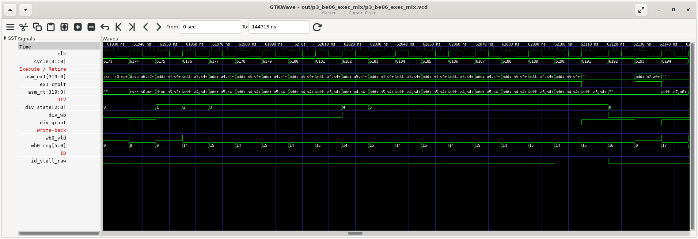

# Phase 3: CPU Pipeline Back-End (IU, RTU)

> **기간**: Week 4-5
> **목표**: 실행(IU)과 retire(RTU)를 RTL 과 사이클 실측으로 이해한다. 분기 판정, 곱셈/나눗셈 latency, precise exception 이 어떻게 만들어지는지 확인한다.
> ⚠️ v2 정정: (1) 나눗셈은 "radix-2 에 32 cycle 고정"이 아니라 **2bit/cycle + 몫 비트 수 비례 + 결과 버퍼**로 2~36 cycle (2) mispredict penalty 실측 **3 cycle** (3) **PC 는 파이프라인을 따라 전달되지 않고 IU 가 직접 계산**한다 (4) 인터럽트 우선순위에 NMI 는 없고 C906 커스텀 원인(16/17/18)이 있다 (5) wb0/wb1 은 "정수/FP" 가 아니라 "rbus(IU/CP0/VPU)/LSU" 포트다.
> ⚠️ v3 추가 (`p3_be05`, `p3_be06`): (6) 64bit 곱셈에서 피연산자가 32bit 를 넘으면 **EX1 에서 4 사이클 split** 하고 latency 가 6 이다 (7) EX1 에서 기다리는 두 번째 DIV 는 **그 뒤 명령을 모두 막는다** (8) wb0 포트는 **EX1 결과 > DIV > MUL** 순으로 중재되어 ALU 가 계속 오면 MUL·DIV 결과 쓰기가 밀린다 (9) load→분기 예외는 **같은 rd 에 진행 중인 writer 가 1 개 이하일 때만** 적용된다

---

## 1. Back-End Overview

```
 ID ──EX1 래치──┬─> IU : ALU (1 cycle) · BJU (분기 판정) · MULT (3 단) · DIV (반복)
                ├─> LSU : AG(EX1) → DC(EX2)          ── Phase 4
                ├─> CP0 : CSR · trap CSR · fence      ── Phase 5
                └─> VIDU/FPU                         ── Phase 6
                         │
                         ▼
 RTU (EX2) : in-order retire 1/cycle · 예외/인터럽트 처리 · flush · redirect
             write-back : wb0 (rbus: IU/CP0/VPU), wb1 (LSU)
             forward    : fwd0~2 → IDU
```

- **retire 는 사이클당 1 개, 항상 프로그램 순서**. 그래서 예외가 정확하다(precise): 예외 명령 이전은 모두 반영, 이후는 모두 버림.
- 한 명령이 EX1 에 있을 때 다음 사이클 retire 되는 것이 기본 (ALU: EX1 → RT). MUL 은 EX3 에서 결과, LOAD 는 EX2 에서 데이터.
- retire 와 write-back 이 왜 다른 시점인지, retire 시점에 무엇이 정해지는지는 3.6 절.
- add · mul · div · load · store 가 사이클 단위로 어떻게 흐르는지는 3.7 절, hazard 전체는 4 절.

---

## 2. IU (Integer Unit)

### 2.1 구성

```
gen_rtl/iu/rtl/ (9 files)
```

| 파일 | 역할 |
|-----|-----|
| `aq_iu_top.v` | IU top |
| `aq_iu_alu.v` | 산술/논리/shift/비교, RV64 W 연산 |
| `aq_iu_bju.v` | 분기/점프 판정, **IU 의 PC 생성기**, mispredict, BHT/RAS 갱신 신호 |
| `aq_iu_addr_gen.v` | 분기 target 덧셈기 |
| `aq_iu_mul.v`, `booth_code_33_bit.v`, `multiplier_33x33_partial.v` | 곱셈기 |
| `aq_iu_div.v`, `aq_iu_div_shift2_kernel.v` | 나눗셈기 (2bit/cycle) |

### 2.2 ALU (`aq_iu_alu.v`)

| 분류 | 명령 |
|-----|-----|
| 산술 | ADD, SUB, ADDI, ADDW, SUBW, ADDIW |
| 논리 | AND, OR, XOR, ANDI, ORI, XORI |
| Shift | SLL, SRL, SRA (+I, +W) — RV64 shamt 6bit, W 형은 5bit |
| 비교 | SLT, SLTU, SLTI, SLTIU |
| 상위 즉치 | LUI, AUIPC |
| C906 확장 | XThead 산술/비트 조작 (MXSTATUS.THEADISAEE=1 일 때) |

- **1 cycle**: EX1 에서 결과가 나오고, 다음 명령이 바로 쓸 수 있다(forward). 실측: 의존 ALU 32 개 = 35 cycle (`p3_be01_hazard` MARK 2, 기준 3 포함).
- W 연산: 하위 32bit 결과를 64bit 로 부호 확장 (부록 A 4 절).

### 2.3 Multiplier (`aq_iu_mul.v`)

- 33bit Booth radix-4 인코더 + 33×33 부분곱 배열. UM: "16×16, 32×32, 64×64 지원".
- **3 단 파이프라인**: EX1 → EX2 → EX3 에서 write-back (`iu_rtu_ex3_mul_wb_vld`).

| 실측 (`p3_be02_muldiv`) | cycles | 해석 |
|---|---|---|
| mul 의존 체인 ×16 | 51 | (51-3)/16 = **latency 3** |
| mulh 의존 체인 ×16 | 51 | 상위 64bit 도 같은 latency |
| mulw 의존 체인 ×16 | 51 | |
| mul 독립 ×16 | 21 | **throughput 1/cycle** (파이프라인) |
| mul → 바로 사용 (×16 쌍, `p3_be01`) | 67 | 쌍당 +2 stall |
| mul ×16 독립, **64bit 큰 피연산자** (`p3_be06` MARK 22) | 69 | **4 cycle/개** — 아래 split |
| 큰 피연산자 mul → 바로 사용 ×8 (`p3_be05` MARK 7) | 59 | 쌍당 +5 → **latency 6** |

**64bit split** (`aq_iu_mul.v:265-275`, 상태기계 `:353-394`): 곱셈기는 33×33 이다. `mul`/`mulh*` 의 두 피연산자가 모두 "상위 32bit 가 부호 확장"(0 이거나, signed 이고 전부 1)이면 한 번에 끝낸다(`mul_ex1_inst64_nosplit`). 아니면 **IDLE → SPLIT0 → SPLIT1 → CMPLT** 로 32bit 조각 곱을 네 번 하고, 그동안 명령이 **EX1 에 4 사이클 머문다**(뒤 명령도 대기). complete 는 CMPLT 에서 나오므로 retire 도 +4 에 일어난다. 위 표의 "latency 3, throughput 1/cycle" 은 작은 피연산자(`li a2, 3` 등)로 잰 값이다.

```verilog
// aq_iu_mul.v:268-275
assign mul_ex1_src0_high_judge = mul_ex1_src0_tmp[63:32] == 32'b0 ||
                                 mul_ex1_src0_tmp[63:32] == {32{1'b1}} && mul_ex1_src0_sign64;
assign mul_ex1_inst64_nosplit  = mul_ex1_src0_high_judge && mul_ex1_src1_high_judge;
assign mul_ex1_iter_start      = mul_ex1_inst64 && !mul_ex1_inst64_nosplit && idu_iu_ex1_mult_sel;
```

Radix-4 Booth (참고):

| b[2i+1] b[2i] b[2i-1] | 부분곱 |
|---|---|
| 000, 111 | 0 |
| 001, 010 | +M |
| 011 | +2M |
| 100 | -2M |
| 101, 110 | -M |

33bit 승수 → 부분곱 17 개. 2bit 씩 보므로 부분곱 수가 절반이 된다.

### 2.4 Divider (`aq_iu_div.v`) — 가변 latency + 결과 버퍼

- 반복형. `aq_iu_div_shift2_kernel.v` 가 **사이클당 몫 2bit** 를 만든다.
- 시작 전에 피제수/제수를 정규화(leading zero)해서 **몫의 유효 비트 수만큼만** 반복 → 작은 몫은 빨리 끝난다. UM: 2~36 cycle.
- 특수 경우(0 으로 나누기, 피제수 0, signed overflow)는 반복 없이 즉시 (`div_abnormal_res_vld`).
- **결과 버퍼**: 직전 나눗셈과 피연산자/부호/word 가 같으면 EX1 에서 바로 결과 (`div_hit_buffer`).

```verilog
// aq_iu_div.v:343-349
assign div_hit_buffer_res_vld  = div_hit_buffer && !div_abnormal_res_vld;
assign div_ex1_res_vld_raw     = (div_abnormal_res_vld || div_hit_buffer_res_vld) && div_is_idle;
assign div_ex1_res_onehot[3:0] = {div_hit_buffer_res_vld, div_dividend_eq0 && !div_divisor_eq0,
                                  div_divisor_eq0, div_res_overflow};
// aq_iu_div.v:779-787
assign div_hit_buffer = div_dividend_hit_buffer && div_divisor_hit_buffer
                     && div_signed_hit_buffer   && div_word_hit_buffer;
```

| 실측 (`p3_be02_muldiv`, TIC/TOC 포함, 기준 addi = 4) | cycles | 순수 |
|---|---|---|
| divu (2^64-1) / 3 | 39 | ≈35 (몫 64bit → 32 회) |
| remu (2^64-1) / 3 | 39 | 몫과 나머지를 같이 만든다 |
| divu 0x1_2345_6789 / 1 | 24 | ≈20 (몫 33bit) |
| divu 1000 / 3, div -1000 / 3, divw 1000 / 3 | 15, 12, 12 | |
| divu 7/7, 3/7, big/big | 8 | |
| ÷0, 0÷3, (-2^63)÷(-1) | 5 | ≈1 (abnormal) |
| divu → 같은 피연산자 remu | 16 (divu 만: 15) | **rem 은 +1** |

> ⚠️ 측정 함정: 처음에는 워밍업으로 같은 나눗셈을 한 번 실행한 뒤 측정해서 모두 3~5 cycle 이 나왔다. 결과 버퍼 때문이다. 지금 테스트는 직전에 "다른 피연산자"로 실행해 버퍼를 비운다.

- 나눗셈 중에는 DIV 유닛이 busy(`iu_idu_div_full`)다. 그동안 **DIV 가 아닌 명령은 EX1 을 지나 계속 실행·retire 된다**(3.7 절, `p3_be06` MARK 31: div 4 개 + addi 40 개 = 48 cycle, 이상적 47).
- 하지만 **다음 DIV 는 EX1 에서 앞 DIV 가 끝날 때까지 기다리고, in-order 라서 그 뒤 명령도 전부 같이 멈춘다**(`ID-stall:EX1-busy`). 독립 div 4 개 = 36 cycle(≈ 8/개), div 와 mul 을 번갈아 4 쌍 = 36 cycle 로 같다(MARK 25, 32). 나눗셈을 연달아 쓰지 말고 사이에 다른 일을 넣어야 하는 이유다.
- DIV 결과는 forward 경로가 없다(fwd0 = EX1, fwd1 = MUL EX3, fwd2 = LSU DC). 사용 명령은 레지스터 파일에 실제로 쓰일 때까지 ID 에서 기다린다.

### 2.5 BJU — 분기 판정과 mispredict



```verilog
// aq_iu_bju.v:611-616 - 조건 판정 (beq/bne/blt/bge/bltu/bgeu 를 두 비교기로)
assign bju_cond_br_taken_raw = (bju_beq_taken ^ bju_op_func[3]) & bju_op_func[2]   // beq/bne
                             | (bju_blt_taken ^ bju_op_func[3]) & bju_op_func[1];  // blt(u)/bge(u)
assign bju_cond_br_taken     = bju_ex1_inst_no_depd || bju_entry_pop ? bju_cond_br_taken_raw
                                                                     : bju_bht_pred[1];
// aq_iu_bju.v:637-653 - 예측 실패 종류
assign bju_bht_mispred_no_entry = bju_cond_sel && (bju_cond_br_taken ^ bju_bht_pred[1])
                                  && bju_ex1_inst_no_depd;                 // EX1 에서 바로 판정
assign bju_bht_mispred_entry    = bju_cond_sel && (bju_cond_br_taken ^ bju_bht_pred[1])
                                  && bju_entry_pop;                         // 피연산자 대기 후 판정
assign bju_pc_reg_mispred  = bju_inst_jalr && idu_iu_ex1_src0_reg[4:0] != 5'b1; // ret 아닌 jalr
assign bju_tar_pc_vld      = bju_tar_pc_vld_raw || bju_ras_mispred_vld;    // → iu_ifu_tar_pc_vld
```

- **BJU entry**: load 결과에 의존하는 분기(`ld a4; bnez a4`)는 ID 에서 멈추지 않고 BJU 의 entry 에 들어가 데이터를 기다렸다가 판정한다(`bju_entry_pop`). `p3_be01` 의 load→branch 가 쌍당 +0.5 로 load-use(+1)보다 싼 이유.
- 판정 결과는 IFU 로 돌아가 BHT 카운터(`iu_ifu_bht_pred/taken`), GHR, RAS 확정 포인터를 갱신한다.

**Penalty 실측** (`p3_be03_mispred_penalty`, 같은 루프 256 회, 분기 조건만 다름)

| 분기 | cycles | mispredict |
|-----|-------|-----------|
| 예측 가능 (항상 not-taken) | 2842 | 7 |
| 예측 불가 (xorshift 난수 bit) | 3517 | 217 |

penalty ≈ (3517 − 2842) / (217 − 7) = **3.2 cycle** — 예측이 맞은 taken 분기의 IP redirect(2 cycle) 비용이 일부 섞여 있다. 순수 BJU redirect 는 3 cycle (Phase 2 의 (c) 사이클 표).

### 2.6 IU 의 PC 생성기 — PC 는 파이프라인을 따라 흐르지 않는다

IFU 의 fetch PC 와 별개로, IU 는 EX1 에 있는 명령의 PC 를 **스스로 계산**한다. 직전 명령이 끝날 때 `next_pc = 분기 taken ? target : pc + 길이(2/4)` 로 갱신한다.

```verilog
// aq_iu_bju.v:681-701
// PC update:
// 1. reset  2. ifu chgflow  3. bju entry chgflow  4. inst cmplt pc(inc pc and ex1 chgflow pc)
always @ (posedge bju_clk)
begin
  if (ifu_iu_reset_vld)
    bju_pcgen_pc_39_1[38:0] <= cp0_xx_mrvbr[39:1];
  else if (ifu_iu_chgflw_vld)                       // RTU 의 trap/mret 등
    bju_pcgen_pc_39_1[38:0] <= ifu_iu_chgflw_pc[39:1];
  else if (bju_not_ex1_chgflw)                      // entry 분기/RAS mispredict
    bju_pcgen_pc_39_1[38:0] <= bju_not_ex1_tar_pc[39:1];
  else if (rtu_iu_ex1_cmplt && !rtu_iu_ex1_inst_split)
    bju_pcgen_pc_39_1[38:0] <= bju_next_pc_update[38:0];
end
assign iu_rtu_ex1_cur_pc[39:0] = bju_pcgen_pc[39:0];
```

- 장점: IF → ID → EX1 래치마다 40bit PC 를 들고 다닐 필요가 없다(면적/전력). 명령 길이(`inst_len`)만 내려보낸다.
- 분기 target 은 이 PC 에 즉치값을 더해 BJU 에서 계산 → IFU 의 예측 target 과 비교할 필요 없이 "방향"만 비교하면 된다(jal 은 IFU 계산이 항상 정확, jalr 은 RAS 예측 PC `ifu_iu_ex1_pc_pred` 와 비교).
- RTU 의 retire PC(`rtu_pad_retire_pc`)는 IU 가 넘겨 준 EX1 PC 를 한 단 늦춘 것이다.

---

## 3. RTU (Retire Unit)

### 3.1 구성

```
gen_rtl/rtu/rtl/ (7 files)
```

| 파일 | 역할 |
|-----|-----|
| `aq_rtu_top.v` | RTU top |
| `aq_rtu_rbus.v` | IU/CP0/VPU 결과 버스, IDU 로 forward(fwd0~2) |
| `aq_rtu_retire.v` | retire 판정, 예외/인터럽트 처리, flush/redirect |
| `aq_rtu_wb.v` | write-back 포트 (wb0 = rbus, wb1 = LSU) |
| `aq_rtu_int.v` | 인터럽트 우선순위 인코더 |
| `aq_rtu_ctrl.v`, `aq_rtu_dp.v` | 제어/데이터패스 (epc, tval 등) |

### 3.2 Write-back 포트

```verilog
// aq_rtu_wb.v:186-197
assign wb_wb0_vld        = wb_rbus_wb_vld || wb_vpu_wb_vld;   // IU/CP0 결과 (또는 VPU→GPR)
assign wb_wb0_data[63:0] = wb_rbus_wb_vld ? wb_wb_rbus_data[63:0] : ...;
assign wb_wb1_vld        = wb_lsu_wb_vld;                     // LOAD 결과
assign wb_wb1_data[63:0] = wb_wb_lsu_data[63:0];
```

- 정수 RF 는 사이클당 최대 2 개 쓰기(ALU 결과 + 앞선 load 결과가 겹칠 때). smart_run 의 tb.v 가 PASS magic 값을 `wb_wb0_data`/`wb_wb1_data` 에서 찾는 이유.
- **wb0 는 한 사이클에 하나만 쓸 수 있어서 중재한다** (`aq_rtu_rbus.v`). 우선순위는 **EX1 결과(ALU·BJU·CP0·LSU) > DIV > MUL** 이다. EX1 결과는 기다릴 곳이 없으니 항상 이기고, DIV·MUL 은 진 사이클에 결과를 들고 대기한다.

```verilog
// aq_rtu_rbus.v:467-468
assign rbus_div_wb_grant = !rbus_ex1_wb_dp;                     // EX1 에 쓸 결과가 없을 때만
assign rbus_mul_wb_grant = !rbus_ex1_wb_dp && !rbus_div_wb_dp;  // EX1 도 DIV 도 없을 때만
// aq_iu_mul.v:561 - grant 를 못 받으면 MUL 은 EX3 에 머문다
assign mul_ex3_stall  = mul_ex3_wb_vld && !rtu_iu_mul_wb_grant;
```

  `addi x0` 같은 nop 도 ALU 명령이라 EX1 에 있으면 wb0 를 차지한다(`iu_rtu_ex1_alu_wb_dp = idu_iu_ex1_alu_dp_sel`, `aq_iu_alu.v:854`). wb1 은 LSU 전용이라 경쟁이 없다. 결과가 실제로 어떻게 밀리는지는 3.7 절.

### 3.3 예외 (precise exception) — trap 진입 과정



`p3_be04_trap` MARK 1(ecall) 의 사이클:

| cycle | 사건 |
|-------|-----|
| 2738 | ecall 이 EX1 (CP0 로 dispatch, 예외 정보 생성) |
| 2739 | ecall 이 retire 단계 → `rt_expt`=1, mepc ← 0x290(ecall 자신), mcause ← 11, MPIE ← MIE, MPP ← M |
| 2740 | `rt_redirect`=1, redirect PC = mtvec(0x140 `__trap_entry`), 파이프라인 flush |
| 2744 | `__trap_entry` 가 EX1 (I$ hit 기준 redirect 후 4 cycle) |
| 2747 | `trap_handler` 첫 명령 EX1 |

| 실측 (warm) | 값 |
|---|---|
| TIC ~ handler 의 `csrr mcycle` | 14 cycle |
| ecall → mret 으로 돌아와 TOC 까지 | 38 cycle |
| ecall: mcause / mepc - 명령주소 | 11 / 0 |
| illegal(`unimp` = csrrw x0,cycle,x0): mcause / mtval | 2 / 0xC0001073 (명령 인코딩) |
| ebreak: mcause / mtval | 3 / 0 |
| 비정렬 ld, MXSTATUS.MM=1 | 예외 없음, 7 cycle (정렬 6) |
| 비정렬 ld, MM=0 | mcause 4, mtval = 주소 |

```verilog
// aq_cp0_trap_csr.v:1039-1048 - mepc : 위임되지 않은 예외면 RTU 가 준 EPC 저장
  else if(rtu_yy_xx_expt_vld && !mdeleg_vld_dp)
    mepc_reg[62:0] <= rtu_cp0_epc[63:1];
// aq_cp0_trap_csr.v:669-677 - MPIE
  else if(rtu_yy_xx_expt_vld && !mdeleg_vld_dp)  mpie <= mie_bit;   // trap: MIE 를 백업
  else if(iui_regs_inst_mret)                    mpie <= 1'b1;      // mret 후 1
```

**예외의 출처** (`aq_rtu_retire.v:443-458`)

| 종류 | 출처 | 정확성 |
|-----|-----|-------|
| sync | EX1 에서 판정된 예외(illegal, ecall, 비정렬, page fault…) + breakpoint | precise: 그 명령을 retire 하지 않음 |
| async | LSU 의 **버스 에러**(AXI 응답 오류) — load 면 cause 5, store 면 7 | imprecise: 이미 뒤 명령이 진행된 뒤 보고될 수 있음 |

### 3.4 인터럽트 — retire 시점에 받는다

```verilog
// aq_rtu_int.v:37-53 - 우선순위 (위가 높음)
casez(int_vld_raw[14:0])
  15'b1?????????????? : int_vec = 5'd16; // mcip (C906 커스텀)
  15'b01????????????? : int_vec = 5'd18; // mhip (C906 커스텀)
  15'b001???????????? : int_vec = 5'd11; // meip  machine external (PLIC)
  15'b0001??????????? : int_vec = 5'd3;  // msip  machine software (CLINT)
  15'b00001?????????? : int_vec = 5'd7;  // mtip  machine timer (CLINT)
  15'b000001????????? : int_vec = 5'd9;  // seip
  15'b0000001???????? : int_vec = 5'd1;  // ssip
  15'b00000001??????? : int_vec = 5'd5;  // stip
  15'b000000001?????? : int_vec = 5'd17; // moip  HPM counter overflow (C906 커스텀)
  ...                                     // 아래는 S 로 위임된 같은 원인들
// 받는 조건 : 디버그 마스크가 없고, split 명령 중간이 아닐 때
assign int_vld = |int_vld_raw[14:0] && !dtu_rtu_int_mask && !dp_int_ex2_inst_split;
```

- 표준 우선순위(MEI > MSI > MTI > SEI > SSI > STI)를 따르고, C906 커스텀 원인 16/17/18 이 추가된다. **NMI 는 없다**(디버그 halt 는 별도 경로, Phase 7).
- 자세한 인터럽트 실험은 Phase 5 (`p5_sys02_timer_irq`, 진입 과정의 사이클 분석은 6 절의 `p5_sys04_ext_irq` / `p5_sys05_ipi`).

### 3.5 Flush 와 redirect

| 신호 | 언제 |
|-----|-----|
| `rtu_yy_xx_flush` | 예외/인터럽트/mret/sret/fence.i 등으로 파이프라인 전체를 비울 때 |
| `rtu_ifu_chgflw_vld/_pc` | 새 fetch 주소 (mtvec, mepc, 다음 명령 …) — next-PC 우선순위 2 번 |
| `iu_ifu_tar_pc_vld/_pc` | 분기 mispredict, JALR — RTU 를 거치지 않고 EX1 에서 바로 (3 cycle) |

분기 mispredict 는 RTU 를 기다리지 않는다 — in-order 라 분기보다 앞선 명령은 이미 앞에 있고, 뒤 명령(ID/IP/IF)만 버리면 되기 때문.

### 3.6 "순서대로 확정"의 의미와 retire 시점에 정해지는 것들

**retire(확정)** 는 명령의 결과가 아키텍처 상태(레지스터, CSR, 메모리, 다음 PC)에 반영되어 더 이상 되돌릴 수 없게 되는 시점이다. 그 전까지는 flush 로 지울 수 있다.

**어떤 순서인가 — 프로그램이 실제로 실행되어야 하는 순서(동적 program order)**

- **fetch 순서와 다르다.** 예측이 틀린 경로의 명령도 fetch 되지만 retire 전에 flush 된다.
- **바이너리에 적힌 순서와도 다르다.** taken 분기와 점프는 그 사이 명령을 건너뛴다. 루프는 같은 PC 가 여러 번 retire 된다.

| 바이너리 순서 | `beq` 가 taken 일 때 retire 순서 |
|---|---|
| `A` → `beq x, y, C` → `B` → `C:` | `A`, `beq`, `C` (`B` 는 fetch 됐어도 retire 되지 않음) |

파형의 `rt_pc` 가 바로 이 순서다(Phase 1 의 7.4 절).

**C906 에서 retire 시점이 정해지는 방식**

```verilog
// aq_rtu_ctrl.v:142-148 - EX1 에 있는 명령을 맡은 유닛이 "complete" 를 올린다
assign ctrl_ex1_cmplt = ctrl_ex1_alu_cmplt || ctrl_ex1_mul_cmplt || ctrl_ex1_bju_cmplt
                     || ctrl_ex1_div_cmplt || ctrl_ex1_lsu_cmplt || ctrl_ex1_vec_cmplt
                     || ctrl_ex1_cp0_cmplt;
// aq_rtu_ctrl.v:162-168 (리셋 생략) - 한 사이클 뒤(EX2)가 retire
always @(posedge cmplt_clk)  ctrl_ex2_cmplt <= ctrl_ex1_cmplt;
assign ctrl_ex2_retire_vld = ctrl_ex2_cmplt;
```

- EX1 래치는 하나뿐이고 ID 는 프로그램 순서대로 한 사이클에 하나씩 보낸다. 그래서 EX1 에서 complete 되는 순서가 곧 프로그램 순서이고, retire 도 저절로 순서대로 된다. out-of-order 코어처럼 순서를 다시 맞추는 ROB 가 필요 없다.
- 여기서 **complete 는 "결과가 나왔다"가 아니라 "이 명령은 더 이상 예외를 내지 않는다(확정해도 된다)"** 에 가깝다. 유닛별 조건은 다음과 같다.

| 유닛 | EX1 에서 complete 하는 조건 | 결과를 레지스터에 쓰는 시점 |
|---|---|---|
| ALU · BJU | EX1 에서 계산이 끝나면 | 바로 다음 사이클 (wb0) |
| MUL | `iu_rtu_ex1_mul_cmplt` (`aq_iu_mul.v:588`) | EX3 (`iu_rtu_ex3_mul_wb_vld`) |
| DIV | **EX1 에 들어오자마자** (`iu_rtu_ex1_div_cmplt = idu_iu_ex1_div_sel`, `aq_iu_div.v:755`) | 2~36 cycle 뒤 (`iu_rtu_div_wb_vld`, 포트 grant 후) |
| LSU | AG 가 stall 없이 주소 변환·정렬·권한 검사를 끝내면 (`ag_pipe_cmplt_req`, `aq_lsu_ag.v:1184`) | load: DC(EX2) 에서 hit 면 바로, miss 면 refill 뒤 (wb1). store: retire 뒤 STB 를 거쳐 D-Cache 로(Phase 4) |
| CP0 | `cp0_rtu_ex1_cmplt` | wb0 (rbus) |

- 그래서 **retire 와 write-back 은 다른 사건**이다. MUL, DIV, miss 난 load 는 retire 된 뒤에 결과가 레지스터에 쓰인다. 그 결과를 쓰려는 뒤 명령은 IDU 의 WBT 가 ID 에서 막고(4 절, Phase 2 의 3.3 절), 쓰기 포트는 RTU 가 중재한다(`rtu_iu_mul_wb_grant`, `rtu_iu_div_wb_grant`).
- 교과서 5 단(IF-ID-EX-MEM-WB)과 비교하면, C906 은 **retire 는 EX2 라는 고정 시점**이고 **write-back 은 유닛마다 다른 시점**이다. 고정된 WB 단계가 따로 있는 것이 아니다.
- load 의 버스 에러가 imprecise(3.3 절 표)인 것도 같은 이유다. 응답이 올 때는 그 load 가 이미 retire 되어 뒤 명령이 진행된 뒤일 수 있다.

**retire 시점에 정해지는 것들**

| 무엇 | 어떻게 | 관련 |
|---|---|---|
| 예외 진입 | EX1 에서 판정된 예외가 retire 단계에서 trap 으로 확정된다. mcause/mepc/mtval, MPIE/MPP 갱신 | 3.3 절 |
| mepc 값 | 동기 예외 → 그 명령의 PC(`dp_retire_ex2_cur_pc`). 인터럽트·비동기 예외 → 다음 PC(`dp_retire_ex2_next_pc`). 단 split 명령에 걸린 비동기 예외는 자기 PC | Phase 5 의 6 절 |
| 인터럽트 수락 | retire 되는 명령 경계에서만 받는다. split 명령의 중간에서는 받지 않는다 | 3.4 절 |
| 뒤 명령 취소 | retire 단계가 flush 를 걸면 EX1 에 있던 명령의 commit 을 지운다(`retire_ctrl_commit_clear`, `aq_rtu_retire.v:918` → `aq_rtu_ctrl.v:160`). 그 명령은 결과를 남기지 않는다 | 3.5 절 |
| 새 fetch 주소 | trap → mtvec, mret/sret → mepc/sepc, fence.i 등 → `rtu_ifu_chgflw_pc` | 3.5 절 |
| store 의 메모리 반영 | retire 된 store 만 STB 에 들어가 D-Cache 로 내려간다 | Phase 4 의 2.3 절 |
| 디버그 halt | retire 되는 명령의 정보(`rtu_dtu_retire_halt_info`)로 halt 여부를 판단한다 | Phase 7 |

반대로 **분기 mispredict 는 retire 를 기다리지 않는다**(3.5 절). in-order 라서 분기보다 앞선 명령은 이미 앞에 있으므로, EX1 의 BJU 가 바로 앞단을 고쳐도 순서가 깨지지 않는다.

---

### 3.7 유닛별 실행 흐름 — add, mul, div, load, store

모든 명령은 같은 규칙을 따른다. **EX1 에서 complete → 다음 사이클(EX2) retire.** 달라지는 것은 (a) EX1 을 몇 사이클 차지하는가, (b) 결과가 언제 나오는가, (c) 다음 명령이 그 결과를 언제 쓸 수 있는가(forward 여부), (d) 레지스터 파일에는 언제 쓰는가 네 가지다.



`p3_be06_exec_mix` MARK 1~7 의 pipeview 에서 읽은 값이다. 가로축은 명령이 EX1 에 들어간 사이클을 +0 으로 둔다.

| 명령 | EX1 점유 | retire | 결과가 나오는 곳 | 사용 명령 EX1 | RF 쓰기 (포트) |
|---|---|---|---|---|---|
| `add` | 1 | +1 | EX1 (+0) → fwd0 | **+1** | +1 (wb0) |
| `mul` 작은 값 | 1 | +1 | EX3 (+2) → fwd1 | **+3** | +3 (wb0, grant 필요) |
| `mul` 64bit 큰 값 | **4** (split) | **+4** | EX3 (+5) → fwd1 | **+6** | +6 (wb0) |
| `divu 1000/3` | 1 | +1 | 반복 끝 (+8), forward 없음 | **+10** | +9 (wb0, grant 필요) |
| `ld` hit | 1 (AG) | +1 | DC (+1) → fwd2 | **+2** | +2 (wb1) |
| `ld` miss | 1 (AG) | +1 | refill 뒤 (≈ +50~60) | ≈ +51~61 | 데이터 다음 사이클 (wb1) |
| `sd` | 1 (AG) | +1 | — (DC 에서 STB 로) | 같은 주소 `ld` 는 STB forward, stall 0 | 없음 |

**add (ALU)**
```
cyc 3156  EX1  add a6,s4,s5        ← 계산 끝, complete, fwd0 에 결과
cyc 3157  RT   add                 wb0:a6        EX1 addi a7,a6,1 (fwd0 로 받음)
```
- 결과가 EX1 에서 바로 나오므로 다음 명령이 stall 없이 쓴다(4 절 "예외 1").
- retire 와 레지스터 쓰기가 같은 사이클이다. 교과서 5 단의 "WB" 가 따로 없다.

**div (반복형)**
```
cyc 4270  EX1  divu a6,s2,s3       ← 들어오자마자 complete (aq_iu_div.v:755)
cyc 4271  RT   divu                DIV 준비(WFI2)            ID: addi a7,a6,1 RAW stall
cyc 4272                           ALIGN (선행 0 정규화)
cyc 4273~77                        ITER × 5 (2bit/cycle)
cyc 4278                           CMPLT (결과 준비, grant 요청)
cyc 4279                           wb0:a6       ← EX1 이 비어 있어 grant
cyc 4280  EX1  addi a7,a6,1
```
- **retire 는 +1, 결과는 +9.** retire 는 "더 이상 예외가 없다"는 뜻이라 DIV 는 들어오자마자 확정된다(나눗셈은 예외를 내지 않는다. 0 으로 나누기도 정해진 값을 돌려줄 뿐이다).
- forward 경로가 없어서 사용 명령은 RF 에 쓰인 사이클에야 ID 를 통과한다.

**load (hit / miss)**
```
hit : cyc 4599 EX1(AG) ld a6 → 4600 RT + DC hit(fwd2) → 4601 wb1:a6, EX1 addi a7,a6,1
miss: cyc 4976 EX1(AG) ld a6 → 4977 RT + DC miss → … refill … → 5026 데이터(fwd2) → 5027 wb1:a6, EX1 addi
```
- 주소 변환, 정렬, 권한 검사는 AG(EX1)에서 끝난다. 그래서 page fault 등은 precise 하고 load 는 +1 에 retire 된다.
- **miss 난 load 도 +1 에 retire 된다.** 그 뒤 독립 명령은 refill 을 기다리지 않고 계속 retire 된다. MARK 10 에서는 miss 뒤 ALU 16 개가 모두 refill 중에 retire 됐다. MARK 11 에서는 miss 뒤의 hit load 4 개가 miss 데이터보다 **먼저** wb1 에 썼다. 즉 hit-under-miss 가 된다.
- 기다리는 것은 그 결과를 쓰는 명령뿐이다(WBT 가 ID 에서 막는다).
- refill 버스 에러는 이미 retire 된 뒤에 오므로 imprecise 다(3.3 절).

**store**
- AG 에서 주소, DC 에서 데이터와 tag 를 확인하고 +1 에 retire 된다. 메모리 반영은 retire 뒤 STB → D-Cache 로 따로 진행된다(Phase 4 의 2.3 절).
- 바로 뒤의 같은 주소 load 는 STB 에서 데이터를 받는다(`STB-fwd`, MARK 7, stall 0).

**wb0 중재가 실제로 밀리는 모습** (3.2 절의 우선순위)

| MARK | 코드 | cycles | 무슨 일이 있었나 |
|---|---|---|---|
| 12 | `mul a6` + 독립 addi 16 개 + `addi a7,a6` | 22 (손실 0) | MUL 결과가 +2 에 나왔지만 EX1 에 계속 ALU 가 있어서 **16 사이클 동안 EX3 에서 대기**(`mul_ex3_stall`). 그동안에도 fwd1 은 유효해서 사용 명령은 stall 없이 받았다. 실제 쓰기는 ALU 흐름이 끊긴 뒤였다 |
| 9 | `divu a6` + 독립 addi 16 개 + `addi a7,a6` | 23 (손실 2) | DIV 결과가 +8 에 준비됐지만 **WFWB 상태로 9 사이클 대기**. forward 가 없으니 사용 명령이 ID 에서 RAW stall 하고, 그 stall 로 EX1 이 비는 사이클에 비로소 grant 를 받았다 |
| 8 | `divu` + 독립 addi 4 개 + 사용 | 14 (= MARK 4) | ALU 4 개는 DIV 반복 안에 숨었다 |


`mul_wb`(= 결과 있음, fwd1 유효)는 7845 부터 1 인데, `mul_grant` 는 ALU 가 EX1 을 떠난 7861 에야 1 이 된다. 그 사이 `wb0_reg` 는 계속 14/15(a4/a5, ALU 결과)이고, a6(16)은 7862 에 쓰였다.



`div_state` 4(CMPLT) → 5(WFWB) 가 6182~6191 이다. `id_stall_raw` 가 뜬 뒤 EX1 이 빈 6191 에 `div_grant` 가 1, 6192 에 `wb0_reg` = 16(a6).

**정리**
- **retire 시점은 유닛과 무관하게 "EX1 을 떠나는 다음 사이클"이다.** 늦어지는 경우는 EX1 을 오래 차지하는 경우(64bit split MUL, fence.i 등)뿐이다.
- **결과를 쓰는 시점은 유닛마다 다르고, 다른 명령의 영향도 받는다.** load 는 전용 포트(wb1)라 영향이 없다. MUL·DIV 는 wb0 를 EX1 결과에 양보한다.
- 그래서 C906 에서 latency 가 긴 명령의 비용은 대부분 **사용 명령이 ID 에서 기다리는 시간**으로 나타난다. 사용 명령을 멀리 떼어 놓으면(4.2 절) 그 비용이 사라진다. 단 DIV 는 결과를 쓸 틈이 필요하다.

---

## 4. Hazards 정리

C906 은 in-order 단일 issue 다. 피연산자는 ID 에서 읽고 결과는 정해진 forward 경로(fwd0~2) 또는 레지스터 파일로만 받는다. 그래서 hazard 는 대부분 **ID stall** 로 나타난다. ID 는 WBT(write-back table)를 보고 판단한다(Phase 2 의 3.3 절). WBT 는 x1~x31 마다 "쓸 명령이 진행 중인가, 생산자 유닛은 무엇인가, 진행 중인 writer 가 몇 개인가(cnt)"를 기록한다.

### 4.1 한눈에 보기

| 종류 | 상황 | C906 처리 | 비용 (실측) |
|-----|-----|---------|-----|
| RAW | ALU/BJU → 사용 | EX1 forward (fwd0) | 0 |
| RAW | load → 사용 | ID stall, DC 데이터 forward (fwd2) | 거리 1: +1, 거리 2 이상: 0 |
| RAW | mul → 사용 | ID stall, EX3 forward (fwd1) | 거리 1/2/3: +2/+1/0 |
| RAW | 64bit 큰 값 mul → 사용 | 위와 같음 + EX1 split 4 사이클 | latency 6 |
| RAW | div → 사용 | ID stall, **forward 없음** (RF 쓰기까지) | 1000/3 기준 사용 명령 EX1 +10 |
| RAW | load → 조건분기 | 예외 2: 분기가 EX1 에서 데이터를 기다림 | 0, **단 같은 rd 에 writer 2 개면 +1** |
| RAW | load → store 데이터 | 예외 4: DC 단계에서 데이터를 읽음 | 0 |
| RAW | load → store 주소, mul → store 데이터 | 예외 없음 | +1, +2 |
| WAW | load ; 같은 rd 에 ALU | ID stall (load 가 쓸 때까지) | +2 |
| WAW | mul ; 같은 rd 에 ALU | ID stall (mul 이 쓸 때까지) | +3 |
| WAW | load ; load, mul ; mul (같은 rd) | ID stall | +1, +2 |
| WAW | ALU ; 같은 rd 에 load | 없음 | 0 |
| WAR | — | in-order + 읽기가 ID 에서 끝남 → 없음 | — |
| 구조적 | DIV 반복 중 다음 DIV | 다음 DIV 가 EX1 에서 대기 → **뒤 명령 전부 대기** | 나눗셈 latency |
| 구조적 | 64bit 큰 값 mul | EX1 4 사이클 점유 | +3/개 |
| 구조적 | wb0 포트 (EX1 > DIV > MUL) | MUL 은 EX3, DIV 는 WFWB 에서 대기 | 대개 0, DIV 결과 사용 시 +2 정도 |
| 구조적 | LSU 가 miss 처리 중 | 뒤 load 는 hit 이면 진행 (hit-under-miss) | 거의 0 |
| 제어 | 분기 mispredict / JALR | IU redirect | 3 |
| 직렬화 | CSR 읽기 | 앞 명령이 모두 retire 할 때까지 ID 대기 | +2 |
| 직렬화 | CSR 쓰기 | 위 + retire 때 flush 하고 다음 명령부터 다시 fetch | ≈ +6.6 |
| 직렬화 | fence / fence.i | 기다릴 메모리 동작이 없으면 fence 는 0. fence.i 는 EX1 에 오래 머문다 | 0 / ≈ 800 |

아래 수치는 모두 `p3_be05_hazard_dist`(따로 적은 것 제외)이다. 블록은 두 번 실행해 두 번째 값을 쓰고, 명령 N 개 블록의 이상값은 N+3 이다.

### 4.2 거리 — 몇 명령 떨어지면 stall 이 사라지나

| 생산자 → 사용 | 거리 1 | 거리 2 | 거리 3 | 해석 |
|---|---|---|---|---|
| `ld` (hit) | 51 / 35 → **+1** | 51 / 51 → **0** | 67 / 67 → 0 | 데이터가 DC(+1)에서 나온다 |
| `mul` 작은 값 | 67 / 35 → **+2** | 67 / 51 → **+1** | 68 / 67 → 0 | EX3(+2)에서 나온다 |
| `mul` 큰 값 | 59 / 19 → +5 | (거리 4) 68 / 43 → +3 | (거리 7) 92 / 67 → +3 | 남는 +3 은 EX1 split 비용(구조적) |

(값은 "측정 / 이상값 → 쌍당 추가". 16 쌍, 큰 값 mul 은 8 쌍)

- 컴파일러가 load 결과를 바로 쓰지 않고 독립 명령 하나를 끼워 넣으면 load-use stall 이 없어진다. mul 은 두 개가 필요하다.
- **"latency = 사용 명령이 EX1 에 들어갈 수 있는 최소 거리"** 로 읽으면 3.7 절 표와 맞는다: ALU 1, load 2, mul 3, 큰 값 mul 6.

### 4.3 같은 rd 를 연달아 쓰면 — WBT 의 cnt

WBT 엔트리에는 그 레지스터를 쓸 명령이 몇 개 진행 중인지 세는 2bit `cnt` 가 있다(`aq_idu_id_wbt_entry.v:126-153`, 들어오면 +1, 쓰면 -1). forward 예외 일부는 이 cnt 를 본다.

```verilog
// aq_idu_id_ctrl.v:435-445
  //2. if producer is load and consumer is bju condbr
  || (src0_type == LSU) && (inst_src_type == BJU) && condbr
     && ((src0_cnt == 2'd0) || (src0_cnt == 2'd1))        // ← writer 가 1 개 이하일 때만
  //3. if result of producer can be forwarded
  || dp_ctrl_src0_fwd_vld
     && !(((src0_type == LSU) || (src0_type == MULT)) && (src0_cnt == 2'd2));
```

| MARK | 코드 (×16 쌍) | cycles | |
|---|---|---|---|
| 10 | `ld a4` ; `bnez a4` (같은 rd) | 43 | **두 쌍마다 +1** |
| 11 | `ld a4` ; `bnez a4` ; `ld a5` ; `bnez a5` (번갈아) | 35 | 0 |
| 12 / 13 | `ld` → `addi` 사용, 같은 rd / 번갈아 | 51 / 51 | 차이 없음 (어차피 +1) |
| 14 / 15 | `mul` → 거리 2 사용, 같은 rd / 번갈아 | 67 / 67 | 차이 없음 |

- 같은 rd 일 때는 앞 쌍의 load 가 아직 wb1 에 쓰기 전인데 다음 load 가 또 a4 를 쓰기로 등록한다. 그래서 cnt = 2 가 되고, 분기의 예외 2 가 꺼져 ID 에서 1 사이클 기다린다. 기다리는 동안 앞 load 가 쓰고 나면 다음 쌍은 다시 cnt = 1 로 시작한다. 그래서 **두 쌍에 한 번**이다. `p3_be01` 의 "+0.5" 도 이 때문이다.
- 실제 코드에서는 루프가 같은 레지스터에 load 하고 분기하는 일이 흔하다(`ld t0, 0(a0); beqz t0, ...`). 레지스터를 번갈아 쓰면 이 stall 이 사라진다.

### 4.4 WAW — 생산자별로 다르다

| MARK | 코드 (×16 쌍) | cycles | 쌍당 | 이유 |
|---|---|---|---|---|
| 16 | `mul a4` ; `li a4, 7` | 83 | **+3** | ALU 가 mul 결과 쓰기(+3)를 기다린다. 먼저 쓰면 나중에 mul 이 덮어쓴다 |
| (`p3_be01` 11) | `ld a4` ; `li a4, 7` | 67 | +2 | load 쓰기(+2)를 기다린다 |
| 17 | `ld a4` ; `ld a4` | 51 | +1 | |
| 19 | `mul a4` ; `mul a4` | 67 | +2 | |
| 18 | `li a4` ; `ld a4` | 66 | (ALU → load 는 0) | +2 는 다음 쌍의 `ld a4` → `li a4` WAW 이다 |

- ALU 끼리, ALU → 다른 유닛은 WAW stall 이 없다. 앞 명령이 먼저 쓰는 것이 보장되기 때문이다. 늦게 쓰는 생산자(load, mul, div) 뒤에 같은 rd 를 일찍 쓰는 명령이 오면 순서가 뒤집힐 수 있어서 기다린다.
- WAR 은 없다. 피연산자는 ID 에서 모두 읽고, 뒤 명령이 앞 명령보다 먼저 쓰는 일이 위 규칙으로 막히기 때문이다.

### 4.5 소비자 종류

| MARK | 코드 (×16 쌍) | cycles | 쌍당 | |
|---|---|---|---|---|
| 22 | `ld a4` ; `sd a4` (store 데이터) | 35 | 0 | 예외 4: store 데이터는 DC 단계에서 읽는다 |
| 23 | `ld a4` ; `sd s4, 8(a4)` (store 주소) | 51 | +1 | 주소는 AG(EX1)에서 필요 |
| 20 | `mul a4` ; `sd a4` (store 데이터) | 67 | +2 | 예외 4 는 load 생산자에만 적용 |
| 21 | `ld a4` ; `mul a5, a4, s5` | 53 | +1 | 일반 load-use |

### 4.6 직렬화 — CSR, fence

| MARK | 코드 (×8) | cycles | 개당 | |
|---|---|---|---|---|
| 24 | addi ×3 ; `csrr a4, mstatus` | 51 (이상 35) | **+2** | 앞 명령이 retire 할 때까지 ID 대기(`ctrl_dis_cp0_stall`) |
| 25 | addi ×3 ; `csrw sscratch, s4` | 88 | **≈ +6.6** | 위 대기 + retire 때 `RT-redirect` 로 뒤 명령을 flush 하고 다시 fetch |
| 26 | addi ×3 ; `fence` | 35 | **0** | 끝내야 할 load/store 가 없으면 바로 지나간다 |
| 27 | addi ×3 ; `fence.i` (×4) | 3201 | **≈ 800** | fence.i 가 EX1 을 약 780 사이클 차지한다 |

- 유닛 테스트의 `csrr mcycle`(TIC/TOC)이 "앞 명령이 모두 끝난 시각"을 읽는 것도 이 직렬화 덕분이다.
- CSR 쓰기 뒤에 flush 하는 것은 그 CSR 이 바로 다음 명령의 해석에 영향을 줄 수 있어서다(예: mstatus.FS, satp).
- fence.i 가 그렇게 오래 걸리는 이유는 RTL 로 확인하지 않았다. I-Cache 전체 무효화(와 D-Cache clean)일 것으로 추정한다. 자체 수정 코드나 JIT 에서 fence.i 를 자주 부르면 안 되는 이유다.

### 4.7 같은 명령 연속 vs 다른 명령 섞기

`p3_be06_exec_mix` MARK 20~33. 의존성은 없고, 블록 명령 수가 N 이면 이상값은 N+3 이다.

| 블록 | N | cycles | 해석 |
|---|---|---|---|
| ALU ×32 | 32 | 35 | 기준. 1 개/cycle |
| mul ×32 (작은 값) | 32 | 37 | 1 개/cycle 로 파이프라인된다. +2 는 마지막 mul 의 꼬리(TOC 가 결과를 기다림) |
| mul ×16 (큰 값) | 16 | 69 | 4 cycle/개. EX1 split 이 throughput 을 결정한다 |
| ld ×32 (hit) | 32 | 36 | 1 개/cycle |
| sd ×32 | 32 | 35 | 1 개/cycle (STB 가 흡수) |
| div ×4 (1000/3) | 4 | 36 | **≈ 8 cycle/개**, 완전히 직렬. 두 번째 div 가 EX1 에서 뒤를 막는다 |
| (mul, add) ×16 | 32 | 36 | 손실 없음 |
| (mul, add, add) ×11 | 33 | 37 | 손실 없음. MUL 이 EX3 에서 1 사이클 wb0 를 기다렸다가, 다음 mul 이 EX1 에 오면 쓴다 |
| (ld, add) ×16 | 32 | 35 | 손실 없음 |
| (ld, mul) ×16 | 32 | 37 | 손실 없음. **wb0(mul)와 wb1(ld)가 같은 사이클에 쓴다** |
| (ld, sd) ×16 | 32 | 35 | 손실 없음 |
| (mul, ld, add) ×11 | 33 | 37 | 손실 없음 |
| (div, add ×10) ×4 | 44 | 48 | **DIV 가 ALU 뒤에 숨는다.** 결과는 다음 div 가 EX1 에 올 때(EX1 결과가 없는 사이클) 쓴다 |
| (div, mul) ×4 | 8 | 36 | div ×4 와 같다. mul 은 DIV 반복 중에 공짜로 실행된다 |

정리하면 다음과 같다.

- **파이프라인된 유닛(ALU, MUL, LSU)은 같은 명령을 연속으로 넣어도, 섞어 넣어도 1 개/cycle 이다.** 의존성이 없으면 섞는다고 빨라지지 않는다. 쓰기 포트가 두 개(wb0, wb1)이고, wb0 경쟁은 MUL 이 EX3 에서 잠깐 기다리는 것으로 흡수되기 때문이다.
- **반복형 유닛(DIV)과 split 하는 64bit MUL 은 연속으로 넣으면 직렬이 된다.** 다른 명령을 섞어야 그 시간이 숨는다. 단 64bit split MUL 은 EX1 을 직접 막으므로 섞어도 숨지 않는다.
- 섞기의 효과가 실제로 나는 곳은 **의존성이 있을 때**다. 4.2 절처럼 생산자와 사용자 사이에 독립 명령을 끼우면 stall 이 사라진다.

(Phase 2 의 3.3 절에 WBT 와 예외 규칙 RTL)

---

## 5. Simulation Exercises (유닛 테스트)

```bash
cd smart_run/study/unit_tests
make run T=p3_be01_hazard           # hazard 별 stall
make run T=p3_be02_muldiv           # MUL/DIV latency, 결과 버퍼
make run T=p3_be03_mispred_penalty  # penalty
make run T=p3_be04_trap             # 예외 진입/복귀
make run T=p3_be05_hazard_dist      # hazard 거리, WBT cnt, WAW, 직렬화
make run T=p3_be06_exec_mix         # 유닛별 실행 흐름, 같은 명령 연속 vs 섞기
```

### Lab 3.1: ALU forward 와 load-use
- [ ] `p3_be01` MARK 2(ALU 의존)와 MARK 3(load-use) 의 pipeview 를 비교한다
- [ ] 파형에서 `fwd0_vld/fwd0_reg`, `wb1_vld` 가 언제 뜨는지 본다

### Lab 3.2: MUL/DIV
- [ ] mul 체인과 독립 mul 의 차이로 latency 와 throughput 을 구한다
- [ ] 나눗셈 피연산자를 바꿔(테스트의 DIV1 매크로 한 줄 추가) 몫 비트 수와 사이클 관계를 확인한다
- [ ] MARK 30 에서 remu 가 1 cycle 인 이유를 `div_hit_buffer` 로 설명한다

### Lab 3.3: Mispredict
- [ ] `p3_be03` 에서 penalty 를 계산한다
- [ ] 파형에서 `bju_bht_mispred` → `iu_redirect` → 다음 IF 까지의 사이클을 센다

### Lab 3.4: Precise exception
- [ ] `p3_be04` MARK 1 에서 `rt_expt`, `cp0_mepc`, `cp0_mcause_code`, `rt_redirect_pc` 의 순서를 확인한다
- [ ] MARK 5(비정렬, MM=0)에서 mtval 이 무엇인지 확인한다
- [ ] trap_handler 에서 `mepc + 4` 를 하지 않으면 어떻게 되는지 예측해 본다 (같은 명령에서 무한 trap)

### Lab 3.5: Hazard 거리와 WBT cnt — `p3_be05_hazard_dist`
- [ ] MARK 1~6 으로 load/mul 의 "stall 이 사라지는 거리"를 구하고 3.7 절의 latency 와 맞춰 본다
- [ ] MARK 10 의 pipeview 에서 RAW stall 이 두 쌍에 한 번만 뜨는 것을 확인하고, 그때 앞 load 의 `w1:a4` 가 어느 사이클인지 본다
- [ ] MARK 16 과 `p3_be01` MARK 11 의 차이(+3 / +2)를 생산자의 쓰기 시점으로 설명한다
- [ ] MARK 25 에서 `RT-redirect` 와 `FLUSH` 가 뜨는 사이클을 찾아 csrw 의 비용을 나눠 본다

### Lab 3.6: 실행 흐름과 wb0 중재 — `p3_be06_exec_mix`
- [ ] MARK 1~6 의 pipeview `BACK`/`WB` 열로 f11 그림의 표를 직접 채운다
- [ ] MARK 12 에서 `M3!` 가 몇 사이클 이어지는지, 그동안 사용 명령이 stall 했는지 확인한다 (fwd1)
- [ ] MARK 9 에서 `D:wf` 가 끝나는 사이클과 `ID-stall:RAW` 의 관계를 설명한다
- [ ] MARK 25 와 31 을 비교해 DIV 를 연달아 쓸 때와 ALU 를 섞을 때의 차이를 설명한다
- [ ] (심화) MARK 22 의 피연산자를 `li s6, 0x7fffffff` 처럼 32bit 안으로 바꾸면 사이클이 어떻게 될지 예측하고 확인한다

---

## 6. Checklist

- [ ] ALU/MUL/DIV 의 latency 를 실측값으로 말할 수 있다
- [ ] Booth radix-4 가 부분곱 수를 줄이는 원리를 설명할 수 있다
- [ ] C906 나눗셈이 가변 latency 인 이유와 결과 버퍼를 설명할 수 있다
- [ ] BJU 의 mispredict 3 종(BHT, JALR, RAS)과 BJU entry 를 설명할 수 있다
- [ ] IU 가 PC 를 직접 계산하는 이유와 방법을 설명할 수 있다
- [ ] precise exception 이 in-order retire 로 어떻게 보장되는지 설명할 수 있다
- [ ] sync/async 예외의 차이를 설명할 수 있다
- [ ] 인터럽트 우선순위와 받는 시점(retire, split 중 제외)을 설명할 수 있다
- [ ] add/mul/div/load/store 각각의 retire 시점과 레지스터 쓰기 시점을 사이클로 말할 수 있다
- [ ] wb0 중재 우선순위와, 그 때문에 MUL·DIV 결과 쓰기가 밀리는 상황을 설명할 수 있다
- [ ] load/mul 의 stall 이 사라지는 거리와, 같은 rd 재사용(WBT cnt)이 분기 예외를 끄는 이유를 설명할 수 있다
- [ ] 생산자별 WAW 비용(load +2, mul +3)이 다른 이유를 설명할 수 있다
- [ ] 같은 명령 연속과 섞기가 파이프라인 유닛과 반복형 유닛에서 각각 어떻게 다른지 설명할 수 있다
