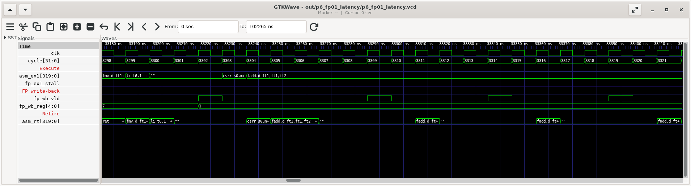
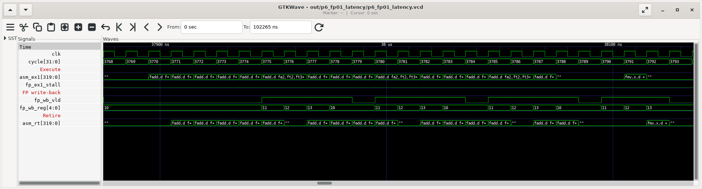
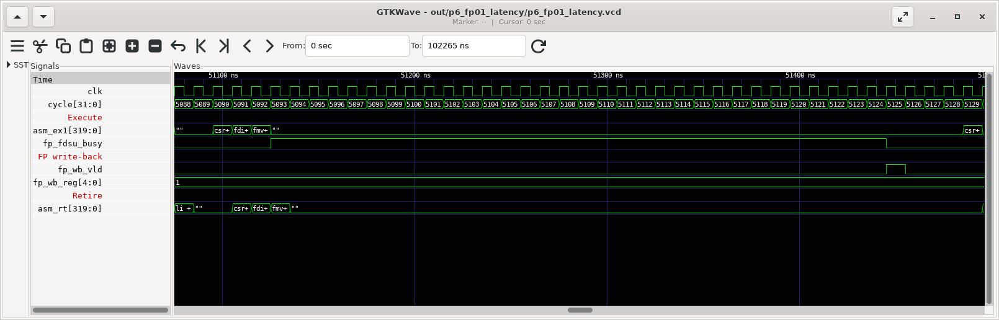
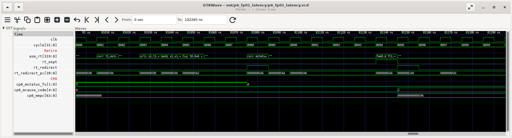

# Phase 6: Floating-Point & Vector Extensions

> **기간**: Week 10-11
> **목표**: IEEE 754 부동소수점 연산의 하드웨어 구현과 FPU 파이프라인 구조를 이해한다.
> ⚠️ v2 정정: (1) 오픈 C906 은 **V 확장이 꺼져 있다**(misa.V=0) — 이 Phase 는 스칼라 FPU 중심이고, RVV 와의 관계는 10 절 (2) FP 유닛은 `aq_vpu_top` 아래에 있다 (3) FDSU 는 radix-4 SRT, UM 2.2.3 의 4~17 cycle 은 단정밀도에 맞고, 실측은 **fdiv.s 17 / fdiv.d·fsqrt.d 32 cycle** (8.0 절)

---

## 1. FPU Overview

C906은 RV64FD (Single + Double precision floating-point) 확장을 지원한다 (UM: 반정밀도 포함, IEEE 754-2008).

RTL 계층: `aq_core` → `x_aq_vidu_top`(FP 디코드/레지스터/WBT) + `x_aq_vpu_top` → `aq_falu_top`, `aq_fcnvt_top`, `aq_fspu_top`, `aq_fdsu_top`, `aq_vfmau_top`, `aq_vlsu_top` (FP load/store).

```
FPU Pipeline:
┌─────────────────────────────────────────────────────┐
│                                                     │
│  VIDU ──→ ┌────────┐                                │
│  (FP     │ VFALU  │ (Add/Sub/Compare/Convert)      │
│  Decode) │        │                                │
│          └────────┘                                │
│                                                     │
│          ┌────────┐                                │
│          │ VFMAU  │ (Multiply-Accumulate, FMA)     │
│          │        │                                │
│          └────────┘                                │
│                                                     │
│          ┌────────┐                                │
│          │ VFDSU  │ (Divide / Square Root)         │
│          │        │                                │
│          └────────┘                                │
└─────────────────────────────────────────────────────┘
```

### 1.1 Floating-Point Register File

```
32 x 64-bit FP Registers (f0-f31):
┌──────┬─────────────────────┐
│ f0   │ ft0 (temporary)     │
│ f1   │ ft1                 │
│ ...  │                     │
│ f8   │ fs0 (saved)         │
│ ...  │                     │
│ f10  │ fa0 (argument/ret)  │
│ f11  │ fa1                 │
│ ...  │                     │
│ f31  │ ft11                │
└──────┴─────────────────────┘

- Single-precision (32-bit): 상위 32비트는 NaN-boxing (all 1s)
- Double-precision (64-bit): 전체 64비트 사용
```

### 1.2 FP CSR (`aq_cp0_float_csr.v`)

```
fcsr (Floating-Point Control and Status):
┌────────────┬──────────┬──────────┐
│   frm      │  fflags  │          │
│  [7:5]     │  [4:0]   │          │
└────────────┴──────────┴──────────┘

frm (Rounding Mode):
┌──────┬──────────────────────────────────┐
│ 000  │ RNE: Round to Nearest, ties Even │
│ 001  │ RTZ: Round Towards Zero          │
│ 010  │ RDN: Round Down (−∞)             │
│ 011  │ RUP: Round Up (+∞)               │
│ 100  │ RMM: Round to Nearest, Max Mag   │
│ 111  │ DYN: Dynamic (from instruction)  │
└──────┴──────────────────────────────────┘

fflags (Exception Flags):
┌────┬────┬────┬────┬────┐
│ NV │ DZ │ OF │ UF │ NX │
│[4] │[3] │[2] │[1] │[0] │
└────┴────┴────┴────┴────┘
NV = Invalid Operation
DZ = Divide by Zero
OF = Overflow
UF = Underflow
NX = Inexact
```

---

## 2. IEEE 754 Basics

### 2.1 Floating-Point Representation

```
Single Precision (32-bit, float):
┌───┬──────────┬───────────────────────┐
│ S │ Exponent │      Mantissa         │
│[31]│ [30:23]  │      [22:0]          │
│1bit│  8 bits  │      23 bits         │
└───┴──────────┴───────────────────────┘
Value = (−1)^S × 2^(Exp−127) × 1.Mantissa

Double Precision (64-bit, double):
┌───┬──────────────┬──────────────────────────────────────┐
│ S │   Exponent   │             Mantissa                 │
│[63]│   [62:52]    │             [51:0]                   │
│1bit│   11 bits    │             52 bits                  │
└───┴──────────────┴──────────────────────────────────────┘
Value = (−1)^S × 2^(Exp−1023) × 1.Mantissa

Special Values:
┌────────────────┬──────────┬──────────────────────┐
│ Type           │ Exponent │ Mantissa              │
├────────────────┼──────────┼──────────────────────┤
│ Zero (±0)      │ 0        │ 0                    │
│ Denormalized   │ 0        │ non-zero             │
│ Normalized     │ 1~2046   │ any                  │
│ Infinity (±∞)  │ 2047     │ 0                    │
│ NaN            │ 2047     │ non-zero             │
│  Signaling NaN │ 2047     │ MSB=0, rest non-zero │
│  Quiet NaN     │ 2047     │ MSB=1                │
└────────────────┴──────────┴──────────────────────┘
```

---

## 3. VFALU (Floating-Point Add/Sub/Compare/Convert)

### 3.1 구조

```
gen_rtl/vfalu/rtl/ (22 files)
```

```
        ┌──────────────────────────────────────────────────┐
        │              VFALU (aq_falu_top)                  │
        │                                                  │
        │  ┌──────────────────────────────────────────┐   │
        │  │         FADD (aq_fadd_double_top)         │   │
        │  │                                          │   │
        │  │  ┌────────┐ ┌────────┐ ┌────────┐       │   │
        │  │  │Special │→│  Add   │→│ Round  │       │   │
        │  │  │ Check  │ │Pipeline│ │        │       │   │
        │  │  └────────┘ └────────┘ └────────┘       │   │
        │  └──────────────────────────────────────────┘   │
        │                                                  │
        │  ┌──────────────────────────────────────────┐   │
        │  │         FCNVT (aq_fcnvt_top)              │   │
        │  │  (Format conversion: FP↔INT, S↔D)        │   │
        │  └──────────────────────────────────────────┘   │
        │                                                  │
        │  ┌──────────────────────────────────────────┐   │
        │  │         FSPU (aq_fspu_top)                │   │
        │  │  (Sign inject, Min/Max, Compare, Class)   │   │
        │  └──────────────────────────────────────────┘   │
        └──────────────────────────────────────────────────┘
```

### 3.2 FP Addition Pipeline

부동소수점 덧셈은 가장 복잡한 FP 연산 중 하나이다.

```
FADD Pipeline Stages:

Stage 1: Special Case Check (aq_fadd_double_special.v)
┌─────────────────────────────────────────────┐
│ - ±Inf, NaN, Zero 입력 검사                  │
│ - Inf + (-Inf) = NaN (Invalid)              │
│ - NaN 전파 규칙 적용                          │
│ - Zero + x = x (shortcut)                   │
└─────────────────────────────────────────────┘
         │
Stage 2: Alignment Shift (aq_fadd_shift_sub_h_double.v)
┌─────────────────────────────────────────────┐
│ - 두 operand의 exponent 비교                 │
│ - Exponent 차이만큼 작은 쪽의 mantissa shift  │
│   예: 1.5 × 2^3 + 1.2 × 2^1                │
│       = 1.5 × 2^3 + 0.3 × 2^3              │
│       (1.2를 오른쪽으로 2bit shift)            │
└─────────────────────────────────────────────┘
         │
Stage 3: Mantissa Addition (aq_fadd_double_add.v)
┌─────────────────────────────────────────────┐
│ - Aligned mantissa 덧셈/뺄셈                 │
│ - Effective operation 결정:                  │
│   same sign → addition                      │
│   different sign → subtraction              │
│ - Leading zero detection (for normalization) │
└─────────────────────────────────────────────┘
         │
Stage 4: Normalization + Rounding (aq_fadd_double_round.v)
┌─────────────────────────────────────────────┐
│ - 결과 normalize: 1.xxx × 2^n 형태로         │
│ - Overflow: exponent 증가, mantissa shift    │
│ - Underflow: denormalized number 처리        │
│ - Rounding (RNE, RTZ, RDN, RUP, RMM)        │
│ - Exception flags 설정 (NX, OF, UF)          │
└─────────────────────────────────────────────┘
```

### 3.3 FP Compare & Sign Operations (FSPU)

```
Compare:
  FEQ.D  → rd = (rs1 == rs2) ? 1 : 0
  FLT.D  → rd = (rs1 < rs2) ? 1 : 0
  FLE.D  → rd = (rs1 <= rs2) ? 1 : 0
  - NaN 비교 시 NV flag 설정 (signaling NaN)

Sign Injection:
  FSGNJ.D  → rd = |rs1| with sign of rs2
  FSGNJN.D → rd = |rs1| with negated sign of rs2
  FSGNJX.D → rd = |rs1| with XOR of signs

  응용: FMOV = FSGNJ(rs1, rs1)
       FNEG = FSGNJN(rs1, rs1)
       FABS = FSGNJX(rs1, rs1)

Min/Max:
  FMIN.D → rd = min(rs1, rs2)
  FMAX.D → rd = max(rs1, rs2)

Classify:
  FCLASS.D → rd = 10-bit classification
  bit 0: −∞, bit 1: −normal, bit 2: −subnormal, bit 3: −0
  bit 4: +0, bit 5: +subnormal, bit 6: +normal, bit 7: +∞
  bit 8: sNaN, bit 9: qNaN
```

### 3.4 Format Conversion (`aq_fcnvt_top.v`)

```
FP ↔ Integer Conversion:
  FCVT.W.D   → int32 = (int32)double
  FCVT.WU.D  → uint32 = (uint32)double
  FCVT.L.D   → int64 = (int64)double
  FCVT.LU.D  → uint64 = (uint64)double
  FCVT.D.W   → double = (double)int32
  FCVT.D.WU  → double = (double)uint32
  FCVT.D.L   → double = (double)int64
  FCVT.D.LU  → double = (double)uint64

FP Format Conversion:
  FCVT.S.D → float = (float)double  (precision loss possible)
  FCVT.D.S → double = (double)float (exact)
```

---

## 4. VFMAU (Floating-Point Multiply-Accumulate)

### 4.1 구조

```
gen_rtl/vfmau/rtl/ (11 files)
```

```
        ┌───────────────────────────────────────────────┐
        │           VFMAU (aq_vfmau_top)                 │
        │                                               │
        │  ┌─────────────────────────────────────────┐  │
        │  │      Multiplier (aq_vfmau_mult)          │  │
        │  │                                         │  │
        │  │  ┌──────────────┐   ┌──────────────┐   │  │
        │  │  │ Booth Encode │──→│ Partial Prod │   │  │
        │  │  │ (54-bit)     │   │ Array        │   │  │
        │  │  └──────────────┘   └──────┬───────┘   │  │
        │  │                           │            │  │
        │  │                    ┌──────▼───────┐   │  │
        │  │                    │ Frac Multiply │   │  │
        │  │                    │ (mantissa)    │   │  │
        │  │                    └──────┬───────┘   │  │
        │  └───────────────────────────┤           │  │
        │                              │            │  │
        │  ┌───────────────────────────▼──────────┐│  │
        │  │         Accumulate + Normalize        ││  │
        │  │  ┌─────────┐  ┌───────┐  ┌────────┐ ││  │
        │  │  │   LZA   │  │ Shift │  │ Round  │ ││  │
        │  │  │(Leading │  │       │  │        │ ││  │
        │  │  │ Zero)   │  │       │  │        │ ││  │
        │  │  └─────────┘  └───────┘  └────────┘ ││  │
        │  └──────────────────────────────────────┘│  │
        └───────────────────────────────────────────┘  │
```

### 4.2 FMA (Fused Multiply-Add)

```
FMA Instructions:
  FMADD.D  → rd = (rs1 × rs2) + rs3
  FMSUB.D  → rd = (rs1 × rs2) − rs3
  FNMADD.D → rd = −(rs1 × rs2) − rs3
  FNMSUB.D → rd = −(rs1 × rs2) + rs3

FMA의 장점:
1. 하나의 rounding만 수행 (separate mul+add는 2번)
   → 더 높은 정밀도
2. 하드웨어 효율: 곱셈과 덧셈을 파이프라인화
3. 과학 계산, DSP에서 핵심 연산

Separate MUL + ADD vs FMA:
  MUL: result_mul = round(rs1 × rs2)     ← 1st rounding
  ADD: result = round(result_mul + rs3)  ← 2nd rounding (error 누적)

  FMA: result = round(rs1 × rs2 + rs3)  ← single rounding (더 정확)
```

### 4.3 Booth Encoding for FP (`booth_code_54_bit.v`)

```
Double Precision Mantissa: 53 bits (1 implicit + 52 explicit)
→ 54-bit Booth encoder (sign extension 포함)

Radix-4 Booth: 54/2 = 27 partial products
→ multiplier_53x27_partial.v에서 합산
```

### 4.4 Leading Zero Anticipator (`aq_vfmau_lza_double.v`)

```
LZA: Normalization에 필요한 shift amount를 미리 계산

일반적 접근: 덧셈 완료 후 leading zero를 세고 shift
LZA 접근: 덧셈과 병렬로 leading zero 수를 예측

→ Normalization latency 감소 (critical path 단축)

LZA Error: 최대 1 bit 오차 → 보정 단계 필요
```

---

## 5. VFDSU (Floating-Point Divide / Square Root)

### 5.1 구조

```
gen_rtl/vfdsu/rtl/ (12 files)
```

### 5.2 SRT Division Algorithm (`aq_fdsu_srt.v`)

```
SRT (Sweeney-Robertson-Tocher) Division:

dividend / divisor = quotient

반복 과정:
1. Prepare: mantissa 추출, exponent 계산
2. Iteration (매 cycle 1-2 quotient bits):
   a. Partial remainder 계산
   b. Quotient digit 선택 (lookup table 기반)
   c. Next partial remainder = remainder × radix − q × divisor
3. 최종 quotient 조립
4. Rounding

Latency: UM 기준 4~17 cycle (radix-4 SRT, 사이클당 몫 2bit). 실측(8.0 절)은 FDSU busy 기준 fdiv.s 17, fdiv.d 와 fsqrt.d 32 cycle 로, 4~17 은 단정밀도 범위로 보인다. 정수 나눗셈기와 마찬가지로 피연산자에 따라 짧아질 수 있다(2.0/2.0 은 5 cycle).

Square Root:
- SRT 알고리즘의 변형
- divisor 대신 중간 결과 사용
- 비슷한 latency
```

### 5.3 FP Divide/Sqrt Pipeline

```
Stage 1: Prepare (aq_fdsu_prepare.v)
  - Special case check (÷0, NaN, Inf)
  - Mantissa/exponent 추출

Stage 2: SRT Iteration (aq_fdsu_srt.v)
  - Multi-cycle iterative computation
  - Radix-2 or Radix-4 per cycle

Stage 3: Denorm Shift (aq_fdsu_denorm_shift.v)
  - Denormalized 결과 처리

Stage 4: Round (aq_fdsu_round.v)
  - IEEE 754 rounding

Stage 5: Pack (aq_fdsu_pack.v)
  - Sign + Exponent + Mantissa 조립
  - Exception flag 생성
```

---

## 6. VIDU (FP/Vector Instruction Decode)

```
gen_rtl/vidu/rtl/ (8 files)
```

```
FP 명령어 전용 디코더:
- FP register file 관리 (f0-f31)
- FP instruction scheduling
- FP-specific hazard detection (WBT)
- FP-Integer data transfer (FMV.X.D, FMV.D.X)
```

---

## 7. FP Instruction Summary

```
Arithmetic:
  FADD.S/D, FSUB.S/D           (add, subtract)
  FMUL.S/D                     (multiply)
  FDIV.S/D                     (divide)
  FSQRT.S/D                    (square root)
  FMADD.S/D, FMSUB.S/D         (fused multiply-add/sub)
  FNMADD.S/D, FNMSUB.S/D       (negated FMA)
  FMIN.S/D, FMAX.S/D           (min, max)

Compare:
  FEQ.S/D, FLT.S/D, FLE.S/D   (compare → integer rd)

Sign:
  FSGNJ.S/D, FSGNJN.S/D, FSGNJX.S/D

Conversion:
  FCVT.W.S/D, FCVT.WU.S/D      (FP → int32)
  FCVT.L.S/D, FCVT.LU.S/D      (FP → int64)
  FCVT.S.W/WU/L/LU              (int → float)
  FCVT.D.W/WU/L/LU              (int → double)
  FCVT.S.D, FCVT.D.S            (float ↔ double)

Move:
  FMV.X.W/D                     (FP reg → integer reg)
  FMV.W.X, FMV.D.X              (integer reg → FP reg)

Load/Store:
  FLW, FLD                      (FP load)
  FSW, FSD                      (FP store)

Classify:
  FCLASS.S/D                    (classify FP value)
```

---

## 8. Simulation Exercises

### 8.0 실측 — `p6_fp01_latency`

```bash
cd smart_run/study/unit_tests && make run T=p6_fp01_latency     # GTKW 그룹: fp ex rt
```

**latency와 throughput** (사이클 = TIC/TOC 차이, 빈 TIC/TOC = 3)

| MARK | 측정 | 결과 | 해석 |
|---|---|---|---|
| 1 | `fadd.d` 의존 체인 × 16 | 85 | FP write-back이 **5 사이클마다** 한 번 → latency 5 |
| 2 | `fadd.d` 독립 × 16 (목적 레지스터 4개를 돌려 씀) | 41 | 4개 연속 뒤 1 사이클 쉼. 같은 레지스터를 5 사이클 안에 다시 쓰면 WAW로 기다린다 → 매 사이클 하나씩 내려면 독립 레지스터가 5개 이상 필요 |
| 3 | `fmul.d` 의존 체인 × 16 | 85 | latency 5 (fadd.d와 같음) |
| 4 | `fmadd.d` 의존 체인 × 16 | 108 | write-back 6 사이클 간격 → latency 6 |
| 5 | `fdiv.d` 1/3 | 39 | FDSU busy **32 사이클** |
| 5 | `fdiv.d` 2/2 | 17 | FDSU busy 5 사이클 (짧아지는 원인은 확인하지 않음) |
| 5 | `fsqrt.d` √2 | 39 | FDSU busy 32 사이클 |
| 5 | `fdiv.s` 1/3 | 31 | FDSU busy **17 사이클** — UM의 4~17은 이 범위 |



의존 체인에서는 `fadd.d`가 5 사이클마다 하나씩 retire된다(3305, 3310, 3315, 3320). 다음 `fadd.d`는 앞 결과(f1)를 기다려야 하기 때문이다. 정수 MUL(latency 3)보다 길다.





FDSU는 반복형이라 busy 동안 다음 나눗셈/제곱근을 받지 않는다. 다른 FP 명령은 의존이 없으면 계속 진행할 수 있다.

**fflags** (MARK 6, 연산마다 `fsflags zero`로 지우고 `frflags`로 읽음)

| 연산 | fflags | 비트 |
|---|---|---|
| 1.0 / 0.0 | 0x08 | DZ (0으로 나누기) |
| 0.0 / 0.0 | 0x10 | NV (정의되지 않음, 결과 NaN) |
| 1.0 / 3.0 | 0x01 | NX (반올림됨) |
| 1e300 × 1e300 | 0x05 | OF + NX (오버플로) |
| 1e-300 × 1e-300 | 0x03 | UF + NX (언더플로) |

fflags는 누적(sticky) 비트라 소프트웨어가 지우기 전까지 남는다. 예외가 나도 trap은 일어나지 않는다. RISC-V FP는 플래그만 세우고 기본값(∞, NaN, 0 등)을 결과로 낸다.

**mstatus.FS** (MARK 7)

| 단계 | FS | 결과 |
|---|---|---|
| FP 명령을 쓴 뒤 | 3 (Dirty) | FP 상태가 바뀌었음. OS는 문맥 전환 때 FP 레지스터를 저장해야 한다 |
| `csrc`로 FS = 0 (Off) | 0 | 그 뒤 `fadd.d` → **illegal instruction** (mcause 2), mtval = 0x022170D3 (그 명령의 인코딩) |
| FS = 1 (Initial) | 1 | |
| `fadd.d` 한 번 | 3 (Dirty) | 하드웨어가 FP 레지스터를 고치는 순간 Dirty로 올린다 |



- `mstatus`를 쓰는 `csrc`가 retire될 때 `rt_redirect`가 1이 된다. CSR 쓰기 뒤 파이프라인을 비우고 다시 fetch하는 것이다(8088).
- 6 사이클 뒤 `fadd.d`가 retire 단계에서 예외로 처리되고(8094) mtvec(0x140)으로 간다. mepc = 0x5A6은 그 `fadd.d`의 주소다.
- FS = Off는 OS가 "이 프로세스는 아직 FP를 안 쓴다"고 표시해 두고, 첫 FP 명령에서 trap을 받아 그때 FP 문맥을 준비하는 lazy 방식에 쓰인다.


### Lab 6.1: FP 명령어 실행 관찰

```bash
make runcase CASE=ISA_FP SIM=iverilog DUMP=on
gtkwave work/test.vcd
```

- [ ] FADD.D 실행 과정: operand 읽기 → VFALU → 결과 write-back
- [ ] FP register file 읽기/쓰기 관찰
- [ ] fcsr의 fflags 변화 관찰 (NX, OF 등)

### Lab 6.2: FMA 동작 관찰

- [ ] FMADD.D의 multiply → accumulate → round 과정
- [ ] VFMAU의 multi-cycle 동작
- [ ] Booth partial product 생성

### Lab 6.3: Division / Sqrt 관찰

- [ ] FDIV.D의 SRT iteration 과정
- [ ] 각 iteration에서 quotient bit 생성
- [ ] 총 latency (cycle 수) 측정
- [ ] FDIV 실행 중 pipeline stall 관찰

### Lab 6.4: Special Cases

- [ ] 0.0 / 0.0 → NaN (DZ flag)
- [ ] 1.0 / 0.0 → +Inf (DZ flag)
- [ ] NaN 전파 확인
- [ ] Denormalized number 처리

---

## 9. RISC-V FP 규칙 몇 가지 (스펙)

- FP 연산은 **trap 을 내지 않는다** — 예외는 fflags 에 누적만 된다(UM: "Does not generate floating-point exceptions"). 소프트웨어가 fflags 를 읽어 확인.
- `mstatus.FS` (Off/Initial/Clean/Dirty): FS=Off 면 FP 명령이 illegal. OS 는 Dirty 일 때만 FP 레지스터를 문맥 저장. 유닛 테스트의 crt0 가 FS=Initial 로 켠다.
- NaN-boxing: 단정밀도 값을 64bit 레지스터에 둘 때 상위 32bit 를 모두 1 로. 박싱이 깨진 값을 단정밀도 연산에 넣으면 canonical NaN 으로 취급.
- 동적 반올림(rm=111)은 frm 을 쓰고, frm 이 잘못된 값이면 illegal.

---

## 10. RVV 사용자를 위한 브릿지 — C906 의 '벡터 흔적'

| 관찰 | 설명 |
|-----|-----|
| 디렉토리/모듈 이름 vfalu, vfmau, vfdsu, vidu, vlsu, vdsp(aq_vpu) | 상용 C906 은 RVV 0.7.1(VLEN 128) 옵션이 있고, 벡터 FP 연산을 스칼라 FPU 와 같은 데이터패스에서 처리한다. 같은 소스 트리라 이름이 남아 있다 |
| 오픈 C906 의 misa.V = 0 | `aq_cp0_info_csr.v:150 assign misa_vector = 1'b0;` cpu_cfig.h 에 벡터 정의 없음 |
| smart_run 의 ISA_VECTOR 테스트 FAIL | GCC 13 의 `-march=..v` 는 RVV 1.0 인코딩을 낸다. 상용 C906 의 0.7.1 과도 다르고, 오픈 C906 은 V 자체가 없다 |
| aq_vpu_group_unit ×4, viq | 벡터 lane 그룹/명령 큐 구조의 흔적 — FP 명령도 이 경로로 들어간다 |
| vsetvl 관련 stall (`ctrl_dis_vec_stall`) | IDU 에 남아 있는 벡터 직렬화 로직 |

RVV 0.7.1 ↔ 1.0 의 대표적 차이: vsetvli 의 vtype 인코딩(vlmul/vsew 비트 배치, 1.0 의 ta/ma 정책 비트), load/store 명령 인코딩(0.7.1 의 vlb/vlh/vlw 계열 → 1.0 의 vle8/16/32/64), 마스크 레이아웃(0.7.1 의 MLEN 개념 제거). 상용 C906 용 코드는 T-Head 툴체인(`-march=..._xtheadvector`) 으로 빌드한다.

---

## 11. Checklist

- [ ] IEEE 754 double의 구조 (sign, exponent, mantissa)를 그릴 수 있다
- [ ] FP 덧셈의 4단계 (special check, align, add, round)를 설명할 수 있다
- [ ] FMA가 separate MUL+ADD보다 정확한 이유를 설명할 수 있다
- [ ] SRT division 알고리즘의 기본 원리를 설명할 수 있다
- [ ] 5가지 rounding mode를 나열할 수 있다
- [ ] 5가지 FP exception flag를 설명할 수 있다
- [ ] Leading Zero Anticipator의 역할을 설명할 수 있다
- [ ] NaN-boxing의 의미를 설명할 수 있다
- [ ] mstatus.FS 의 역할을 설명할 수 있다
- [ ] 오픈 C906 에서 V 가 꺼져 있다는 것을 RTL/misa 로 보일 수 있다
