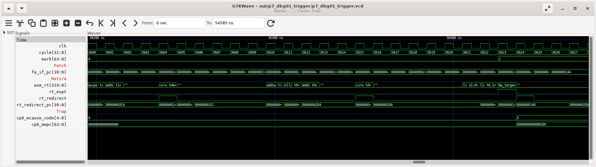
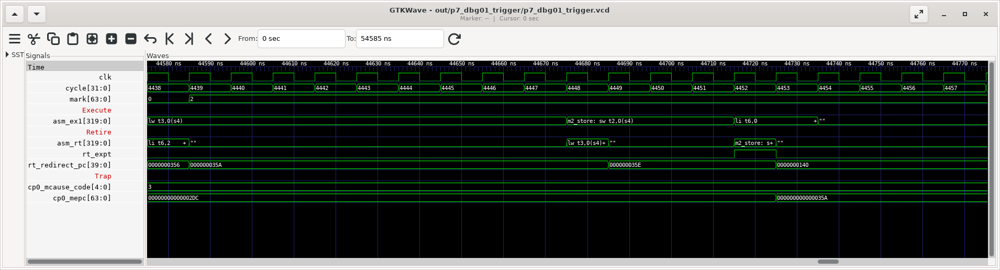

# Phase 7: Debug & Performance Monitoring

> **기간**: Week 12
> **목표**: RISC-V Debug Specification 구현과 Hardware Performance Counter의 동작을 이해한다.
> ⚠️ v2 정정: (1) Debug spec 은 0.13.2 (2) C906 의 이벤트 카운터는 mhpmcounter3~**17** 이고 이벤트 번호는 UM 표 12.9 (5.3 절 교체) (3) 유닛 테스트가 HPM 을 실제로 쓰는 방법 추가(5.6 절).

---

## 1. Debug Infrastructure Overview

C906은 RISC-V External Debug Support 0.13.2 를 구현한다 (UM 1.5).

```
Debug Architecture:

  Host PC (GDB)
      │
      │ USB/JTAG
      ▼
  ┌────────┐
  │  DTM   │ (Debug Transport Module - JTAG TAP)
  │ tdt_dtm│
  └────┬───┘
       │ DMI (Debug Module Interface)
  ┌────▼───┐
  │   DM   │ (Debug Module)
  │ tdt_dm │
  └────┬───┘
       │ Debug Bus
  ┌────▼───┐
  │  DTU   │ (Debug Transfer Unit - CPU side)
  │aq_dtu  │
  └────┬───┘
       │
  ┌────▼───┐
  │  CPU   │ (halt, step, breakpoint, ...)
  │ Core   │
  └────────┘
```

---

## 2. DTM (Debug Transport Module)

### 2.1 JTAG Interface

```
gen_rtl/tdt/rtl/debug/ (DTM files)
```

```
JTAG Signals:
┌──────┬──────────────────────────────────────┐
│ TCK  │ Test Clock                           │
│ TMS  │ Test Mode Select (state machine)     │
│ TDI  │ Test Data In (serial data input)     │
│ TDO  │ Test Data Out (serial data output)   │
│ TRST │ Test Reset (optional)                │
└──────┴──────────────────────────────────────┘

JTAG TAP State Machine:
  Test-Logic-Reset → Run-Test/Idle → ...
  → Select-DR-Scan → Capture-DR → Shift-DR → Update-DR
  → Select-IR-Scan → Capture-IR → Shift-IR → Update-IR
```

### 2.2 DTM 구성 모듈

| File | Description |
|------|-------------|
| `tdt_dtm_top.v` | DTM top-level |
| `tdt_dtm_ctrl.v` | JTAG state machine controller |
| `tdt_dtm_chain.v` | Shift chain (IR/DR) |
| `tdt_dtm_io.v` | JTAG I/O handling |
| `tdt_dtm_idr.v` | JTAG ID Register |

### 2.3 DTM Registers

```
JTAG IR (Instruction Register):
┌────────┬──────────────────────────────────┐
│ 0x01   │ IDCODE - JTAG device ID          │
│ 0x10   │ dtmcs - DTM Control and Status   │
│ 0x11   │ dmi - Debug Module Interface     │
│ 0x1F   │ BYPASS                           │
└────────┴──────────────────────────────────┘

dtmcs Register:
┌───────┬──────┬────────┬────────────────────┐
│ Field │ Bits │ Access │ Description        │
├───────┼──────┼────────┼────────────────────┤
│abits  │[9:4] │ R      │ DMI address size   │
│version│[3:0] │ R      │ DTM version (0.13) │
│dmistat│[11:10]│ R      │ DMI status         │
│dmireset│[16] │ W      │ Reset DMI error    │
└───────┴──────┴────────┴────────────────────┘
```

---

## 3. DM (Debug Module)

### 3.1 DM 구조

```
gen_rtl/tdt/rtl/ (DM files)
```

```
       ┌──────────────────────────────────────┐
DMI ──→│          DM (tdt_dm_top)              │
       │                                      │
       │  ┌──────────┐   ┌──────────┐        │
       │  │ dmcontrol│   │ dmstatus │        │
       │  │(halt/    │   │(running/ │        │
       │  │ resume)  │   │ halted)  │        │
       │  └──────────┘   └──────────┘        │
       │                                      │
       │  ┌──────────┐   ┌──────────┐        │
       │  │ Abstract │   │  Data   │        │
       │  │ Command  │   │ Regs    │        │
       │  │(reg R/W) │   │         │        │
       │  └──────────┘   └──────────┘        │
       │                                      │
       │  ┌──────────┐                        │
       │  │   SBA    │ (System Bus Access)   │──→ AXI
       │  └──────────┘                        │
       └──────────────────────────────────────┘
```

### 3.2 DM Registers

```
주요 DM Registers:
┌───────────┬──────┬───────────────────────────────────┐
│ Register  │ Addr │ Description                       │
├───────────┼──────┼───────────────────────────────────┤
│ dmcontrol │ 0x10 │ Debug Module control              │
│           │      │ - haltreq: halt 요청               │
│           │      │ - resumereq: resume 요청            │
│           │      │ - hartreset: hart reset            │
│           │      │ - dmactive: DM 활성화               │
├───────────┼──────┼───────────────────────────────────┤
│ dmstatus  │ 0x11 │ Debug Module status               │
│           │      │ - allhalted: 모든 hart 정지됨       │
│           │      │ - allrunning: 모든 hart 실행 중      │
│           │      │ - allresumeack: resume 완료         │
├───────────┼──────┼───────────────────────────────────┤
│ command   │ 0x17 │ Abstract command                  │
│           │      │ - cmdtype: 0=reg, 1=quickaccess    │
│           │      │ - regno: register number           │
│           │      │ - write: read(0) or write(1)       │
│           │      │ - transfer: execute transfer       │
├───────────┼──────┼───────────────────────────────────┤
│ data0-11  │0x04-F│ Abstract command data              │
│ progbuf0-7│0x20-7│ Program buffer                     │
└───────────┴──────┴───────────────────────────────────┘
```

### 3.3 Debug Operations

```
Halt CPU:
  1. GDB → DTM → DMI write dmcontrol.haltreq = 1
  2. DM → DTU → CPU halt request
  3. CPU enters Debug Mode (at next instruction boundary)
  4. dmstatus.allhalted = 1

Resume CPU:
  1. GDB → dmcontrol.resumereq = 1
  2. CPU exits Debug Mode
  3. dmstatus.allrunning = 1

Read Register:
  1. command = {cmdtype=0, regno=GPR_number, write=0, transfer=1}
  2. DM reads CPU register via abstract command
  3. Result in data0 register
  4. GDB reads data0

Write Register:
  1. Write data0 = new_value
  2. command = {cmdtype=0, regno=GPR_number, write=1, transfer=1}
  3. DM writes value to CPU register

Single Step:
  1. Set dcsr.step = 1 (Debug CSR)
  2. Resume CPU
  3. CPU executes ONE instruction, then halts again
```

---

## 4. DTU (Debug Transfer Unit - CPU Side)

### 4.1 DTU 구조

```
gen_rtl/dtu/rtl/ (12 files)
```

```
       ┌──────────────────────────────────────────┐
DM ──→ │            DTU (aq_dtu_top)               │
       │                                          │
       │  ┌──────────┐   ┌──────────┐             │
       │  │  Ctrl    │   │ DBG Info │             │
       │  │(halt/   │   │(dcsr,    │             │
       │  │ step)    │   │ dpc)     │             │
       │  └──────────┘   └──────────┘             │
       │                                          │
       │  ┌──────────────────────────────┐        │
       │  │     Trigger Module          │        │
       │  │  ┌───────────┐              │        │
       │  │  │ MControl  │ (HW breakpt) │        │
       │  │  └───────────┘              │        │
       │  │  ┌───────────┐              │        │
       │  │  │ IIE Trig  │ (inst match) │        │
       │  │  └───────────┘              │        │
       │  └──────────────────────────────┘        │
       │                                          │
       │  ┌──────────┐   ┌──────────┐             │
       │  │  CDC     │   │ PC FIFO  │             │
       │  │(Clock   │   │(trace)   │             │
       │  │ Domain)  │   │          │             │
       │  └──────────┘   └──────────┘             │
       └──────────────────────────────────────────┘
```

### 4.2 Hardware Breakpoints (`aq_dtu_mcontrol.v`)

> ⚠️ v3 정정: 예전 표는 action 필드를 [5:0]으로, 값 0과 1의 의미를 반대로 적었다. 아래는 RTL(`aq_dtu_mcontrol.v:446-458, 515-517`)과 실측으로 확인한 내용이다.

C906에는 trigger가 **10개** 있다. 8개는 주소·데이터 비교용 mcontrol(type 2), 2개는 그 밖의 종류다(`cpu_cfig.h:261-265`, 실측 `tselect`에 0~9만 써진다). 소프트웨어는 `tselect`(0x7A0)로 하나를 고르고 `tdata1`(0x7A1)에 조건, `tdata2`(0x7A2)에 비교 값을 쓴다.

**tdata1 (mcontrol, type = 2)**

| 비트 | 필드 | 뜻 |
|---|---|---|
| 63:60 | type | 2 = mcontrol (주소/데이터 비교) |
| 59 | dmode | 1이면 debug mode에서만 고칠 수 있다 |
| 20 | hit | 이 trigger가 걸렸음 (하드웨어가 세움) |
| 19 | select | 0 = 주소 비교, 1 = 데이터 비교 |
| 18 | timing | 0 = 명령을 **실행하기 전**에 trap, 1 = 실행한 뒤 |
| 15:12 | action | **0 = breakpoint 예외(mcause 3)**, **1 = debug mode 진입**. 그 밖의 값은 0으로 고정된다 |
| 11 | chain | 다음 trigger와 AND 조건으로 묶기 |
| 10:7 | match | 0 = 같음, 1 = NAPOT, 2 = ≥, 3 = <, 4/5 = 아래/위 반쪽 마스크 비교 |
| 6, 4, 3 | m, s, u | 어느 특권 모드에서 동작할지 |
| 2, 1, 0 | execute, store, load | 무엇을 볼지: 명령 주소, store 주소, load 주소 |

**tcontrol (0x7A5)**: M 모드에서 action = 0 trigger는 `tcontrol.MTE`(bit 3)가 1일 때만 동작한다(`aq_dtu_mcontrol.v:711`). trap이 들어가면 하드웨어가 MTE를 MPTE(bit 7)로 옮기고 0으로 만든다. 그래서 trap 핸들러 안에서는 같은 trigger가 다시 걸리지 않는다. `mret`이 MPTE를 MTE로 되돌린다.

사용 예:

- 실행 breakpoint (GDB의 `hbreak *0x2dc`): `tdata2 = 0x2dc`, `tdata1 = type 2 | m | execute`, action 0이면 예외, 1이면 debug mode
- store watchpoint (GDB의 `watch var`): `tdata2 = &var`, `tdata1 = type 2 | m | store`

### 4.3 Debug CSRs

```
dcsr (Debug Control and Status Register):
┌────────┬──────────────────────────────────┐
│ cause  │ Debug entry cause                │
│ step   │ Single step mode enable          │
│ ebreakm│ EBREAK in M-mode → debug mode   │
│ ebreaks│ EBREAK in S-mode → debug mode   │
│ ebreaku│ EBREAK in U-mode → debug mode   │
│ prv    │ Privilege level before debug     │
└────────┴──────────────────────────────────┘

dpc: Debug PC (PC when entering debug mode)
dscratch0/1: Debug scratch registers
```

### 4.4 Clock Domain Crossing (`aq_dtu_cdc.v`)

```
JTAG clock (TCK)과 CPU clock은 비동기:
- TCK: 외부 디버거에서 제공 (보통 수 MHz)
- CPU clock: 시스템 클럭 (수백 MHz ~ GHz)

CDC (Clock Domain Crossing) 처리:
- Level synchronizer: 레벨 신호 동기화
- Pulse synchronizer: 펄스 신호 동기화
- Handshake protocol: 데이터 전달 시
```

### 4.5 실측 — `p7_dbg01_trigger`

```bash
cd smart_run/study/unit_tests && make run T=p7_dbg01_trigger     # GTKW 그룹: dbg rt
```

| MARK | 설정 | 결과 |
|---|---|---|
| (시작) | `tselect`에 0~15를 써 보기, `tinfo` 읽기 | trigger 10개, trigger 0의 `tinfo` = 4 (bit 2 = mcontrol 지원) |
| 1 | 실행 breakpoint: `bp_target`의 주소, `tcontrol.MTE = 1` | 그 명령을 **실행하기 전에** mcause 3. mepc = mtval = `bp_target`. 핸들러가 trigger를 끄고 `mret`하면 그 명령이 다시 실행된다(한 번만 더해짐) |
| 2 | store watchpoint: `watch_var` | 같은 주소의 `lw`는 통과, `sw`에서 trap. mepc = 그 `sw`, mtval = 데이터 주소. 돌아와서 store가 실행되어 값이 써진다 |
| 3 | load watchpoint: `watch_var` | 4바이트 떨어진 주소의 `lw`는 통과, 같은 주소 `lw`에서 trap |
| 4 | `tcontrol.MTE = 0`으로 같은 breakpoint | trap이 일어나지 않는다 |
| (핸들러) | trap 안에서 `tcontrol` 읽기 | 128 = MPTE 1, MTE 0 |



- 3604, 3615의 `rt_redirect`는 `csrw tdata2`, `csrw tdata1`이 retire될 때다. trigger CSR을 쓰면 파이프라인을 비우고 다시 fetch한다. 그래서 바로 뒤 명령부터 새 trigger가 적용된다.
- 3623에 `bp_target`(0x2DC)이 retire 단계에서 예외로 처리되고 mtvec(0x140)으로 간다. 명령의 결과는 반영되지 않는다(timing = 0).



- `lw t3, 0(s4)`는 4448에 정상 retire된다. store 조건만 켰기 때문이다.
- `sw`(0x35A)는 4452에 예외로 retire되고 mepc = 0x35A가 된다. 데이터 주소 비교는 LSU의 AG 단계에서 하고, 결과가 명령과 함께 retire까지 실려 간다.

---

## 5. PMU (Performance Monitoring Unit)

### 5.1 PMU 구조

```
gen_rtl/pmu/rtl/ (6 files)
```

```
       ┌──────────────────────────────────────┐
       │          PMU (aq_hpcp_top)            │
       │                                      │
       │  ┌─────────────────────────────┐     │
       │  │     Event Selection         │     │
       │  │   (aq_hpcp_event.v)         │     │
       │  └──────────┬──────────────────┘     │
       │             │                        │
       │  ┌──────────▼──────────────────┐     │
       │  │     Counter Array           │     │
       │  │   (aq_hpcp_cnt.v)           │     │
       │  │                             │     │
       │  │  ┌────────┐ ┌────────┐     │     │
       │  │  │mcycle  │ │minstret│     │     │
       │  │  └────────┘ └────────┘     │     │
       │  │  ┌────────┐ ┌────────┐     │     │
       │  │  │hpmcnt3 │ │hpmcnt4 │ ... │     │
       │  │  └────────┘ └────────┘     │     │
       │  └─────────────────────────────┘     │
       │                                      │
       │  ┌─────────────────────────────┐     │
       │  │  Overflow Interrupt/Enable  │     │
       │  │  (aq_hpcp_cntinten_reg.v)   │     │
       │  │  (aq_hpcp_cntof_reg.v)      │     │
       │  └─────────────────────────────┘     │
       └──────────────────────────────────────┘
```

### 5.2 Standard Performance Counters

```
Fixed Counters:
┌─────────────┬──────────┬─────────────────────────┐
│ CSR         │ Address  │ Description             │
├─────────────┼──────────┼─────────────────────────┤
│ mcycle      │ 0xB00    │ Clock cycle counter     │
│ minstret    │ 0xB02    │ Retired instruction cnt │
│ mcycleh     │ 0xB80    │ Upper 32 bits (RV32)    │
│ minstreth   │ 0xB82    │ Upper 32 bits (RV32)    │
└─────────────┴──────────┴─────────────────────────┘

IPC 계산:
  IPC = minstret / mcycle
  예: minstret=50000, mcycle=80000 → IPC = 0.625
```

### 5.3 Hardware Performance Counter Events (C906 UM 표 12.9)

`mhpmevent3~17` 에 이벤트 번호를 쓰면 대응하는 `mhpmcounter3~17` 이 센다.

| 번호 | 이벤트 | 번호 | 이벤트 |
|-----|-------|-----|-------|
| 0x1 | L1 I-Cache access | 0x1D | ALU 명령 수 |
| 0x2 | L1 I-Cache miss | 0x1E | load/store 명령 수 |
| 0x3 | I-uTLB miss | 0x1F | vector 명령 수 |
| 0x4 | D-uTLB miss | 0x20 | CSR 접근 명령 수 |
| 0x5 | jTLB miss | 0x21 | sync 명령 (AMO/LR/SC) |
| 0x6 | 조건 분기 mispredict | 0x22 | 비정렬 load/store |
| 0x7 | 조건 분기 명령 수 | 0x23 | 응답한 인터럽트 수 |
| 0xB | store 명령 수 | 0x24 | 인터럽트 off 상태 사이클 |
| 0xC | L1 D-Cache read access | 0x25 | ecall 수 |
| 0xD | L1 D-Cache read miss | 0x26 | 8MB 넘는 long jump |
| 0xE | L1 D-Cache write access | 0x27 | front-end stall cycle |
| 0xF | L1 D-Cache write miss | 0x28 | back-end stall cycle |
| | | 0x29 | sync stall cycle (fence/fence.i/sfence) |
| | | 0x2A | FP 명령 수 |

관련 CSR: `mcountinhibit`(0x320, 1 이면 정지), `mcounteren`/`scounteren`(하위 모드 읽기 허용), C906 확장 `mhpmcr`(0x7F0, PC 범위 트리거 모드), `mhpmsp/mhpmep`(0x7F1/0x7F2, 트리거 시작/끝 PC), `mcounterinten`/`mcounterof`(0x7CA/0x7CB, overflow 인터럽트 = mcause 17).

### 5.4 Counter Overflow & Interrupt

```
aq_hpcp_cntof_reg.v:
  - 카운터 overflow 시 flag 설정
  - Overflow interrupt 지원 (sampling-based profiling)

aq_hpcp_cntinten_reg.v:
  - Per-counter interrupt enable
  - Overflow interrupt → CPU trap → software handler
  → Linux perf 등 프로파일링 도구에서 활용
```

### 5.5 Adder Selection (`aq_hpcp_adder_sel.v`)

```
다수의 이벤트가 동시에 발생할 수 있으므로
카운터 증가값을 결정하는 로직

예: 한 cycle에 2개의 cache miss가 발생하면
    counter += 2
```

---

### 5.6 유닛 테스트에서의 사용

`unit_tests/common/crt0.S` 가 부팅 때 다음처럼 연결해 두고, 테스트는 구간 앞뒤로 읽어 차이를 낸다.

| 카운터 | 이벤트 | 쓰는 테스트 |
|-------|-------|-----------|
| mhpmcounter3 | 0x6 조건 분기 mispredict | p2_fe02, p2_fe03, p3_be03 |
| mhpmcounter4 | 0x7 조건 분기 수 | p2_fe03 |
| mhpmcounter5 | 0x2 I-Cache miss | p2_fe01, p4_mem03 |
| mhpmcounter6 / 7 | 0xC / 0xD D-Cache read access / miss | p4_mem01 |
| mhpmcounter8 / 9 | 0x27 / 0x28 front/back-end stall | (자유 실험용) |

```asm
  csrr s3, mhpmcounter3          # 시작 값
  ...                            # 측정 구간
  csrr s1, mhpmcounter3
  sub  s1, s1, s3                # 구간 동안의 mispredict 수
```

- **IPC 실측 팁**: `TIC/TOC` 로 cycle 을, `minstret` 차이로 retire 수를 재면 구간 IPC 가 나온다. pipeview.txt 의 MARK 별 summary 줄에도 `IPC=` 가 계산되어 있다.

## 6. Simulation Exercises

### Lab 7.1: Debug 동작 관찰

```bash
make runcase CASE=debug SIM=iverilog DUMP=on
gtkwave work/test.vcd
```

- [ ] JTAG TCK, TMS, TDI, TDO 신호 관찰
- [ ] DTM state machine 전이 추적
- [ ] DMI 통신 (write dmcontrol → halt CPU)
- [ ] CPU halt/resume 시점 확인

### Lab 7.2: Breakpoint 동작

```bash
cd smart_run/study/unit_tests && make run T=p7_dbg01_trigger
```

- [ ] MARK 1의 mepc, mtval이 `bp_target` 주소인지 확인한다
- [ ] 핸들러에서 trigger를 끄지 않으면 어떻게 되는지 예측한다 (같은 명령에서 다시 trap? `tcontrol`이 막아 주는 범위는?)
- [ ] `tdata1`의 timing을 1로 바꾸면 mepc와 store 실행 여부가 어떻게 달라지는지 확인한다

### Lab 7.3: Performance Counter 관찰

- [ ] mcycle 카운터 매 cycle 증가 확인
- [ ] minstret 카운터와 retire 신호 비교
- [ ] IPC 계산: minstret / mcycle

### Lab 7.4: IPC 분석

```bash
# ISA_INT와 coremark의 IPC 비교
make runcase CASE=ISA_INT SIM=iverilog DUMP=on
# → minstret, mcycle 기록

make runcase CASE=coremark SIM=iverilog DUMP=on
# → minstret, mcycle 기록 (매우 오래 걸릴 수 있음)
```

- [ ] 두 테스트의 IPC 비교
- [ ] IPC가 낮은 구간의 원인 분석 (cache miss? branch mispred?)

---

## 7. Checklist

- [ ] RISC-V Debug Spec의 3-layer 구조 (DTM-DM-DTU)를 설명할 수 있다
- [ ] JTAG 인터페이스의 4개 필수 신호를 나열할 수 있다
- [ ] CPU halt/resume 과정을 단계별로 설명할 수 있다
- [ ] Hardware breakpoint의 설정 및 동작을 설명할 수 있다
- [ ] Abstract command를 통한 레지스터 읽기 과정을 설명할 수 있다
- [ ] Clock Domain Crossing의 필요성을 설명할 수 있다
- [ ] mcycle과 minstret의 차이를 설명할 수 있다
- [ ] IPC의 의미와 이론적 최대값을 설명할 수 있다
- [ ] Hardware performance counter의 event 선택 메커니즘을 설명할 수 있다
- [ ] 유닛 테스트에서 HPM 으로 mispredict / cache miss 를 세어 볼 수 있다
