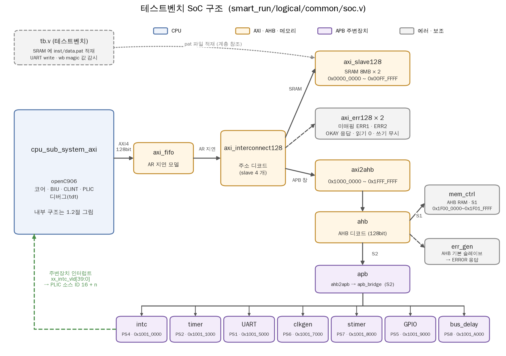
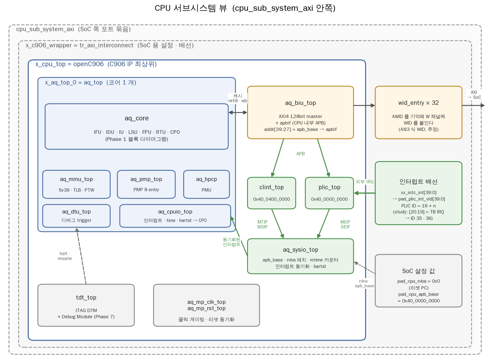
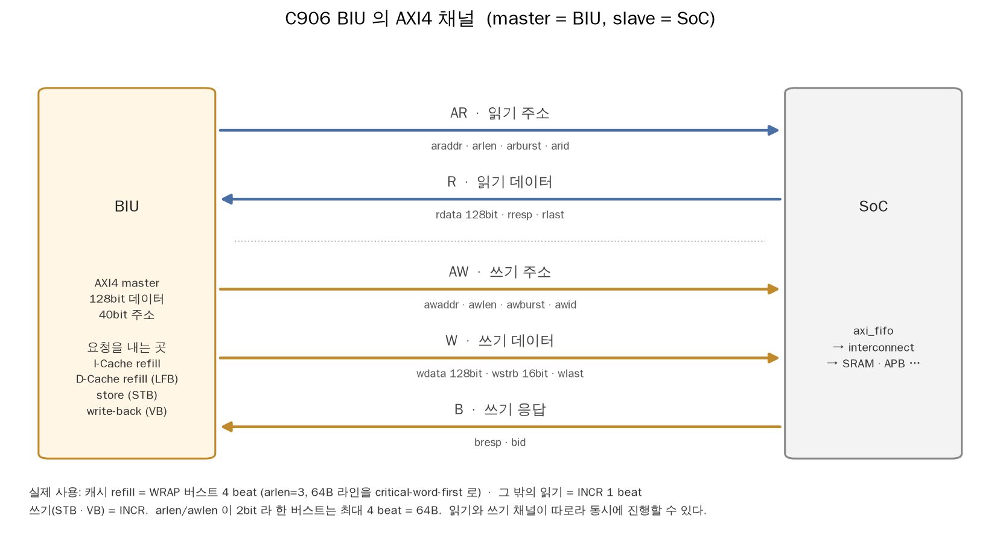
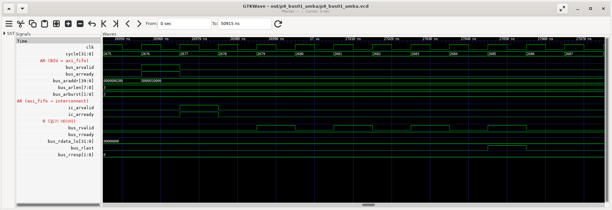
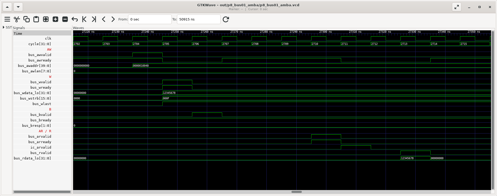
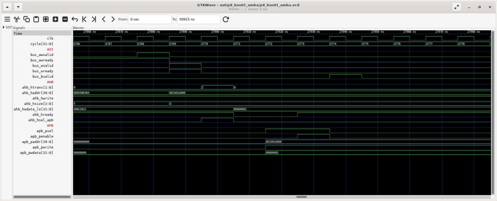
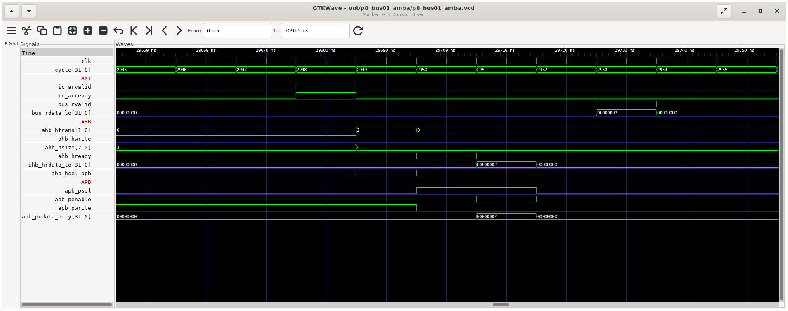
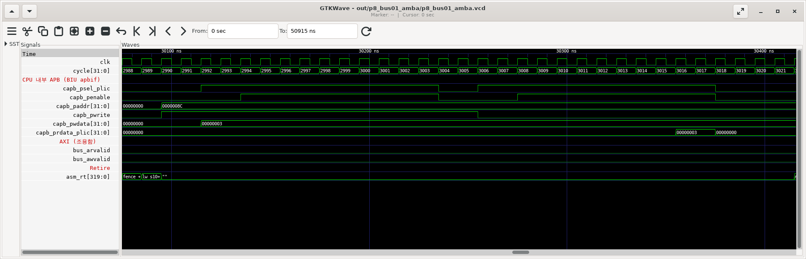
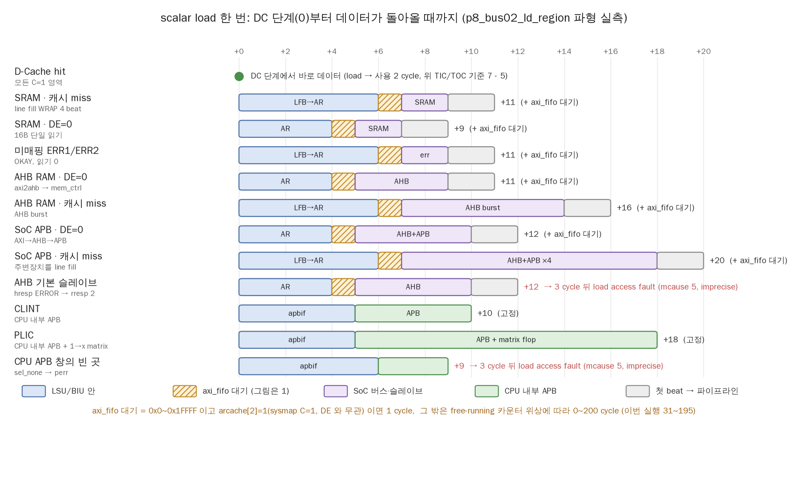

# Phase 8: SoC Integration & Advanced Topics

> **기간**: Week 13+
> **목표**: SoC 전체 통합 구조를 이해하고, 커스텀 테스트 작성 및 성능 분석을 수행한다.
> ⚠️ v2 정정: (1) CLINT/PLIC 는 SoC 버스의 슬레이브가 아니라 **CPU top(openC906) 안**에 있다 (2) SRAM 모델은 8MB × 2 (3) SoC 의 메모리 지연 모델(axi_fifo)과 그 영향(Phase 4 의 5 절) (4) 커스텀 테스트는 유닛 테스트 환경 사용을 권장(4.4 절) (5) 2-issue 등 고급 주제는 부록 B. (6) v3: AHB 는 32bit 가 아니라 **128bit**, AXI 버스트는 최대 16 beat 가 아니라 **4 beat**, 미매핑 구간(axi_err128)은 에러가 아니라 **OKAY 응답**. (7) v4: 영역별 scalar load 의 가능 여부·지연·예외와 그 이유(2.4절, `p8_bus02_ld_region`): AHB 기본 슬레이브와 CPU 내부 APB 빈 곳은 **비동기 load access fault**, 주변장치 창은 SO 가 아니라 **16B 정렬 레지스터만 제대로 읽힌다**.

---

## 1. SoC Architecture

### 1.1 SoC Block Diagram



`smart_run/logical/common/soc.v`는 실제 칩이 아니라 **C906을 시뮬레이션하기 위한 테스트벤치용 SoC**다. C906 IP(`openC906`)를 감싸고, 메모리와 간단한 주변장치를 AMBA 버스(AXI → AHB → APB)로 붙였다. 테스트벤치(`tb.v`)는 이 SoC 하나를 인스턴스로 두고, 메모리에 프로그램을 적재한 뒤 결과를 감시한다.

| 인스턴스 | 모듈 | 역할 |
|---|---|---|
| `x_cpu_sub_system_axi` | `cpu_sub_system_axi` | C906 IP와 SoC용 설정을 묶은 CPU 쪽 덩어리. AXI4 master 포트 하나가 밖으로 나온다(1.2절) |
| `x_axi_fifo` | `axi_fifo` | 읽기 주소(AR) 채널에 지연을 넣는 메모리 지연 모델(Phase 4의 5절) |
| `x_axi_interconnect` | `axi_interconnect128` | AXI 주소를 보고 4개 slave 중 하나를 고른다(2.1절) |
| `x_axi_slave128` | `axi_slave128` | 주 메모리. SRAM 8MB × 2 |
| `x_axi_err`, `x_axi_err1` | `axi_err128` | 미매핑 구간(ERR1, ERR2). 이름과 달리 **OKAY 응답**, 읽으면 0, 쓰기는 버린다 |
| `x_axi2ahb` | `axi2ahb` | AXI 요청을 AHB 요청으로 바꾸는 브리지 (128bit) |
| `x_ahb` | `ahb` | AHB 디코더. S1 = `mem_ctrl`, S2 = APB, 나머지 = `err_gen`(2.2절) |
| `x_mem_ctrl` | `mem_ctrl` | AHB에 붙은 RAM(0x1F00_0000~0x1F01_FFFF). 테스트에서는 쓰지 않는다 |
| `x_err_gen` | `err_gen` | AHB 기본 슬레이브. ERROR 응답(hresp = 01) |
| `x_apb` | `apb` | `ahb2apb` + `apb_bridge` + APB 주변장치(UART, timer, GPIO, …) (2.3, 3절) |

**요청 한 번이 지나가는 길** (예: `lw` 가 D-Cache miss 를 낸 경우)

1. LSU가 miss를 내면 BIU가 AXI AR 채널에 4 beat WRAP 버스트 읽기를 낸다(2.1절).
2. `axi_fifo`가 AR 요청을 잠시 붙잡아 지연을 만든다.
3. `axi_interconnect128`이 주소 0x0~0xFF_FFFF를 보고 `axi_slave128`로 보낸다.
4. SRAM이 R 채널로 128bit × 4 beat를 돌려주고, BIU가 D-Cache 라인을 채운다.

주변장치 접근(예: bus_delay 레지스터 쓰기)은 3단계에서 `axi2ahb`로 가서 AHB → APB를 거친다. PLIC/CLINT 접근은 1단계에서 BIU가 가로채므로 이 그림의 버스에 나타나지 않는다(1.2절).

**클럭과 리셋**

- 코어 클럭과 주변장치 클럭은 같은 입력 `i_pad_clk`이다. `fpga_clk_gen`이 `per_clk = i_pad_clk`, `clk_en = 1`로 둔다(`logical/clk/fpga_clk_gen.v:95-97`). clkgen 레지스터(0x1001_7000)는 BIU에 버스 클럭 비율(`pad_biu_clkratio`, 기본 0)만 알려 준다.
- 리셋은 `pad_cpu_rst_b = i_pad_rst_b & i_pad_jtg_nrst_b`로 외부 리셋과 JTAG 리셋을 합친다.

### 1.2 CPU Subsystem View



SoC 그림의 `cpu_sub_system_axi` 상자를 열면 세 겹으로 되어 있다.

| 층 | 모듈 | 하는 일 |
|---|---|---|
| 1 | `cpu_sub_system_axi` | SoC 쪽에서 보이는 포트 묶음. 안의 wrapper를 그대로 연결한다. study 환경은 이 파일만 바꿔 외부 인터럽트 선 2개를 추가했다(`unit_tests/tb/soc_overlay/`) |
| 2 | `tr_axi_interconnect` (`x_c906_wrapper`) | C906 IP에 SoC용 설정 값을 넣고 배선을 맞춘다: 리셋 PC `pad_cpu_rvba = 0x0`, CPU 내부 APB 창 `pad_cpu_apb_base = 0x40_0000_0000`, 주변장치 인터럽트 `xx_intc_int[39:0]` → `pad_plic_int_vld[39:0]`, AWID를 기억해 W 채널에 WID를 붙이는 `wid_entry` × 32 (AXI3 식 WID로 보인다) |
| 3 | `openC906` (`x_cpu_top`) | T-Head가 배포하는 C906 IP의 최상위. 아래 표의 블록이 들어 있다 |

**openC906 안의 블록**

| 인스턴스 | 역할 |
|---|---|
| `aq_top` (`x_aq_top_0`) | 코어 하나. `aq_core`(IFU, IDU, IU, LSU, FPU, RTU, CP0 — Phase 1의 블록 다이어그램), `aq_mmu_top`(Sv39), `aq_pmp_top`(PMP), `aq_hpcp_top`(성능 카운터), `aq_dtu_top`(디버그 trigger), `aq_cpuio_top`(인터럽트·time·hartid를 CP0로 전달) |
| `aq_biu_top` | AXI4 128bit master. 요청 주소 [39:27]이 apb_base와 같으면 AXI 대신 내부 `apbif`로 보내 PLIC/CLINT에 접근한다(`aq_biu_req_arbiter.v:438`, `aq_biu_apbif.v:287-288`) |
| `plic_top` | 외부 인터럽트 컨트롤러. apbif 주소 bit 26 = 0 이면 PLIC |
| `clint_top` | 타이머·소프트웨어 인터럽트. apbif 주소 [26:16] = 0x400 이면 CLINT |
| `aq_sysio_top` | apb_base와 rvba를 래치하고, mtime 카운터를 돌리고, PLIC/CLINT의 인터럽트를 코어 쪽으로 동기화해서 넘긴다 |
| `tdt_top` | JTAG DTM과 Debug Module (Phase 7) |
| `aq_mp_clk_top`, `aq_mp_rst_top` | 클럭 게이팅과 리셋 동기화 (6.1, 6.2절) |

**인터럽트가 CP0까지 가는 길**

```
SoC 주변장치 (UART, timer, GPIO, stimer)
  → xx_intc_vld[39:0]  (soc.v:335, bit 0 = UART, 2~5 = timer, 7~14 = GPIO, 15~18 = stimer)
  → xx_intc_int[39:0]  (study 환경은 여기에 [20:19] = TB IRQ 를 OR)
  → pad_plic_int_vld[39:0]   → PLIC 소스 ID = 16 + 비트 번호
  → plic_top : 우선순위 · enable · threshold → plic_core0_me_int / se_int
  → aq_sysio_top (동기화) → aq_cpuio_top → CP0 의 mip.MEIP / SEIP

clint_top : mtime ≥ mtimecmp → MTIP,  MSIP 레지스터 → MSIP
  → aq_sysio_top → aq_cpuio_top → CP0 의 mip.MTIP / MSIP
```

인터럽트를 받는 시점(retire 경계)과 우선순위는 Phase 3의 3.4절, 진입 과정의 사이클 분석은 Phase 5의 6절에 있다.

### 1.3 Bus Hierarchy

세 버스는 **빠르고 많이 나르는 것 → 느리고 조금 나르는 것** 순서로 층을 이룬다.

- **AXI4 = 주 버스.** CPU의 BIU가 내는 모든 바깥 접근이 여기로 나간다. I-Cache·D-Cache의 라인 refill, store, dirty 라인 write-back, 캐시를 거치지 않는 접근이다. 대량의 데이터가 오가는 주 메모리(SRAM)가 AXI에 직접 붙는다.
- **AHB = 중간 다리.** `axi2ahb`가 주변장치 창(0x1000_0000~0x1FFF_FFFF)으로 가는 AXI 요청만 받아 AHB로 바꾼다. AHB RAM(`mem_ctrl`)과 APB 브리지가 붙는다.
- **APB = 레지스터 버스.** 저속 주변장치의 설정·상태 레지스터를 32bit 단위로 읽고 쓴다.
  - SoC APB: UART, timer, GPIO, clkgen, stimer, bus_delay, intc
  - CPU 내부 APB: PLIC, CLINT. BIU가 AXI를 거치지 않고 직접 접근한다

| 버스 | 폭 | 연결 | 주소 | 주로 오가는 것 |
|---|---|---|---|---|
| AXI4 | 데이터 128bit, 주소 40bit | BIU → `axi_fifo` → `axi_interconnect128` → SRAM · `axi2ahb` · `axi_err128` × 2 | SRAM 0x0~0xFF_FFFF, APB 창 0x1000_0000~0x1FFF_FFFF, 나머지는 ERR1/ERR2 | 캐시 라인 64B 버스트, store, write-back |
| AHB | 128bit | `axi2ahb` → `ahb` → `mem_ctrl` (S1) · `apb` (S2) · `err_gen` (기본) | S1 0x1F00_0000~0x1F01_FFFF, S2 0x1000_0000~0x1EFF_FFFF | 주변장치로 가는 단일 접근 |
| APB (SoC) | 32bit 레지스터 | `ahb2apb` → `apb_bridge` → 7개 슬레이브 | 0x1001_0000~0x1001_AFFF (3.1절 표) | 주변장치 레지스터 읽기/쓰기 |
| APB (CPU 내부) | 32bit 레지스터 | BIU `apbif` → PLIC, CLINT | 0x40_0000_0000~0x40_07FF_FFFF | 인터럽트 설정, claim/complete, 타이머 비교값 |

메모리 맵 전체와 영역별 역할은 Phase 1의 5.3절에 그림으로 있다.

---

## 2. Bus Protocols

### 2.0 공통 개념 — master, slave, 핸드셰이크

- **master**는 전송을 시작하는 쪽(주소를 낸다), **slave**는 주소를 받아 응답하는 쪽이다. 브리지는 앞 버스의 slave이면서 뒤 버스의 master다.

| 버스 | master | slave |
|---|---|---|
| AXI | BIU | `axi_fifo` → interconnect → SRAM, `axi2ahb`, `axi_err128` |
| AHB | `axi2ahb` | `mem_ctrl`, APB 브리지, `err_gen` |
| APB (SoC) | `apb_bridge` | UART, timer, GPIO, bus_delay, … |
| APB (CPU 내부) | BIU `apbif` | PLIC, CLINT |

- **핸드셰이크**는 "언제 전송이 성립했는가"를 정하는 규칙이다.

| 버스 | 규칙 |
|---|---|
| AXI | 채널마다 `valid`(보내는 쪽)와 `ready`(받는 쪽). **둘 다 1인 클럭에서 한 번 전송**된다. ready가 먼저 1이어도 되고, valid를 올린 쪽은 ready가 올 때까지 내리면 안 된다 |
| AHB | master가 주소 단계에 `HTRANS = NONSEQ`로 주소를 내고, 다음 사이클이 데이터 단계다. slave는 `HREADY = 0`으로 데이터 단계를 늘릴 수 있다 |
| APB | `PSEL = 1`(setup) 한 사이클, 이어서 `PENABLE = 1`(access) 한 사이클. 이 SoC의 APB 브리지에는 대기 신호(PREADY)가 없다 |

- 아래 파형은 모두 유닛 테스트 `p8_bus01_amba`의 실제 시뮬레이션이다(`make run T=p8_bus01_amba`, 웹 뷰어에서 MARK 1~4). 파형의 한 칸이 한 사이클이고, valid와 ready가 같은 칸에서 둘 다 1이면 그 칸에서 전송된 것이다.

| MARK | 하는 일 | 보이는 버스 |
|---|---|---|
| 1 | 캐시 가능한 load miss (0x10000) | AXI AR(WRAP 4 beat) + R |
| 2 | D-Cache 끄고 SRAM `sw` / `lw` (0x10040) | AXI AW + W + B, AR + R (각 1 beat) |
| 3 | D-Cache 끄고 bus_delay(0x1001_A000) `sw` / `lw` | AXI → AHB → APB 쓰기와 읽기 |
| 4 | PLIC 우선순위 레지스터 `sw` / `lw` | CPU 내부 APB만. AXI는 조용하다 |

### 2.1 AXI (Advanced eXtensible Interface)



AXI는 주소와 데이터를 **독립된 5개 채널**로 나눈다. 읽기는 AR(주소) → R(데이터), 쓰기는 AW(주소) + W(데이터) → B(응답)이다. 채널마다 `valid`/`ready` 핸드셰이크가 따로 있어서, 주소를 먼저 여러 개 보내 두고(outstanding) 데이터를 나중에 받을 수 있다. ID(`arid`, `awid`)로 어떤 요청의 응답인지 구분한다.

**C906 BIU가 실제로 쓰는 방식** (RTL 확인)

| 항목 | 값 | 근거 |
|---|---|---|
| 데이터 / 주소 폭 | 128bit / 40bit | `openC906` 포트 |
| 버스트 길이 | `arlen`/`awlen` 2bit → **최대 4 beat = 64B** (캐시 라인 하나) | `aq_biu_req_arbiter.v:428, 490` |
| 캐시 refill | **WRAP** 버스트 4 beat (arlen = 3). 요청한 word부터 돌아서 라인을 채운다 | `aq_ifu_icache.v:1363-1365`, `aq_lsu_lfb.v:913-918` |
| 그 밖의 읽기 (캐시 불가 등) | INCR 1 beat | 같은 곳 |
| 쓰기 (STB, victim buffer) | INCR | `aq_lsu_stb.v:1230`, `aq_lsu_vb.v:469` |
| 요청자 | I-Cache, D-Cache LFB(line fill), STB(store), VB(write-back) | BIU arbiter |

**AXI Interconnect (`axi_interconnect128.v:358-375`)**

| slave | 주소 | 대상 |
|---|---|---|
| s0 | 0x00_0000_0000 ~ 0x00_00FF_FFFF | `axi_slave128` (SRAM) |
| s1 | 0x00_0100_0000 ~ 0x00_0FFF_FFFF | `axi_err128` (ERR1) |
| s2 | 0x00_1000_0000 ~ 0x00_1FFF_FFFF | `axi2ahb` (주변장치) |
| s3 | 0x00_2000_0000 ~ 0xFF_FFFF_FFFF | `axi_err128` (ERR2) |

- PLIC(0x40_0000_0000)와 CLINT(0x40_0400_0000)는 이 표에 없다. BIU가 AXI로 내보내기 전에 가로채기 때문이다(1.2절).
- 미매핑(ERR1/ERR2)은 버스 에러를 내지 않는다. 잘못된 주소를 읽어도 0이 돌아오고 예외가 나지 않으니, 디버깅할 때 주의한다.

#### 실제 파형 ① — 캐시 refill 읽기 (MARK 1)



| cycle | 채널 | 일어난 일 |
|---|---|---|
| 2676 | AR | `arvalid = arready = 1` → 핸드셰이크. 주소 0x10000, `arlen = 3`(4 beat), `arburst = 2`(WRAP). `axi_fifo`가 같은 사이클에 받아 준다 |
| 2677 | AR | `axi_fifo`가 요청을 interconnect로 넘긴다(`ic_arvalid = ic_arready = 1`). 0x0~0x1FFFF 구간이라 지연이 bus_delay 값(0)이다 |
| 2679, 2681, 2683, 2685 | R | `rvalid = 1`인 beat 4개. SRAM이 2 사이클마다 16B씩 보낸다. `rready`는 BIU가 항상 1로 둔다(`aq_biu_read_channel.v:209`) |
| 2685 | R | 4번째 beat에 `rlast = 1`. `rresp = 0`(OKAY) |

요청부터 마지막 데이터까지 9 사이클이다. 바로 앞(2663~2672)에 보이는 0x280 읽기는 이 코드 자체의 I-Cache refill이다.

#### 실제 파형 ② — 캐시를 거치지 않는 쓰기와 읽기 (MARK 2)



| cycle | 채널 | 일어난 일 |
|---|---|---|
| 2704 | AW | `awvalid = 1`. `awready`는 쉬는 동안 이미 1이라 같은 사이클에 성립(ready가 먼저 온 경우). 주소 0x10040, `awlen = 0`(1 beat) |
| 2705 | W | `wvalid = wready = 1`, `wdata = 0x12345678`, `wstrb = 0x000F`(128bit 중 아래 4바이트만 유효), `wlast = 1` |
| 2706 | B | `bvalid = 1`, `bresp = 0`(OKAY). `bready`는 항상 1(`aq_biu_write_channel.v:299`) |
| 2710 | AR | `lw`의 단일 읽기(`arlen = 0`, INCR). 2711에 interconnect로 넘어간다 |
| 2713 | R | `rvalid = rlast = 1`, `rdata = 0x12345678` — 방금 쓴 값 |

- `wstrb`는 128bit 버스에서 실제로 쓸 바이트를 고른다. `sw`(4바이트)라서 비트 4개만 1이다.
- `awready`가 2705~2706 동안 0으로 내려간다. slave가 직전 쓰기를 처리하는 동안 새 주소를 받지 않는 것이다.

### 2.2 AHB (Advanced High-performance Bus)

AHB는 AXI보다 단순한 버스다. 채널이 나뉘지 않고, 한 전송이 **주소 단계 → 데이터 단계**로 파이프라인된다. 이번 전송의 데이터 단계와 다음 전송의 주소 단계가 겹친다. 이 SoC에서는 master가 `axi2ahb` 하나뿐이다.

| 신호 | 의미 |
|---|---|
| HADDR | 주소 |
| HTRANS | 전송 종류 (IDLE / NONSEQ / SEQ). `ahb.v`는 HTRANS[1] = 1 일 때만 slave를 고른다 |
| HWRITE | 쓰기 1 / 읽기 0 |
| HSIZE | 전송 크기 |
| HWDATA / HRDATA | 쓰기 / 읽기 데이터 — 이 SoC는 **128bit** (`axi2ahb.v:119, 131`) |
| HREADY | slave가 전송을 끝냈음 (0 이면 대기) |
| HRESP | 응답 (OKAY / ERROR) |

**이 SoC의 AHB 디코드 (`ahb.v:37-41, 241-243`)**

| 선택 | 주소 | 대상 |
|---|---|---|
| S1 | 0x1F00_0000 ~ 0x1F01_FFFF | `mem_ctrl` (AHB RAM) |
| S2 | 0x1000_0000 ~ 0x1EFF_FFFF | `apb` (APB 브리지) |
| S3 | 그 밖 (S1, S2가 아닐 때) | `err_gen` → HRESP = ERROR |

#### 실제 파형 — AXI 쓰기가 AHB, APB로 내려가는 과정 (MARK 3 앞부분)



| cycle | 버스 | 일어난 일 |
|---|---|---|
| 2768 | AXI AW | BIU가 0x1001_A000 쓰기 주소를 낸다 |
| 2769 | AXI W | 쓰기 데이터 2 |
| 2770 | AHB 주소 단계 | `axi2ahb`가 master가 되어 `HTRANS = 2`(NONSEQ), `HADDR = 0x1001A000`, `HWRITE = 1`. 디코더가 APB 쪽(`hsel_apb`)을 고른다 |
| 2771 | AHB 데이터 단계 | `HWDATA = 2`. APB 브리지가 `HREADY = 0`으로 데이터 단계를 붙잡는다 |
| 2772 | APB setup | `PSEL = 1`, `PENABLE = 0`, `PADDR = 0x1001A000`, `PWRITE = 1`, `PWDATA = 2` |
| 2773 | APB access | `PENABLE = 1` → bus_delay 레지스터에 기록. 같은 사이클에 AHB `HREADY = 1` |
| 2774 | AXI B | 쓰기 응답이 BIU로 돌아온다 |

AXI 쓰기 한 번이 AHB 전송 한 번, APB 전송 한 번으로 바뀌고, 응답이 거꾸로 올라온다. 전체 6 사이클이다. store 자체는 그보다 먼저 retire되어 있다(Phase 3의 3.6절). 그래서 MARK 3이 시작되고 몇 사이클 뒤에 버스 쓰기가 보인다.

### 2.3 APB (Advanced Peripheral Bus)

APB는 레지스터를 읽고 쓰는 저속 주변장치용 버스다. 파이프라인이 없고 **한 전송이 2 사이클**이다.

| 신호 | 의미 |
|---|---|
| PADDR | 주소 |
| PSEL | slave 선택 (슬롯마다 하나) |
| PENABLE | 두 번째(access) 사이클 표시 |
| PWRITE | 쓰기 1 / 읽기 0 |
| PWDATA / PRDATA | 쓰기 / 읽기 데이터 |

1. **Setup 사이클**: PSEL = 1, PENABLE = 0. 주소와 쓰기 데이터를 낸다.
2. **Access 사이클**: PENABLE = 1. 이 사이클에 데이터가 오간다.

이 SoC의 `apb_bridge`에는 PREADY(slave 대기)가 없다. 그래서 모든 접근이 고정 2 사이클이다(APB2 방식). 슬롯 선택은 주소 범위 비교다(`apb_bridge.v:378-386`).

#### 실제 파형 ① — SoC APB 읽기 (MARK 3 뒷부분)



| cycle | 버스 | 일어난 일 |
|---|---|---|
| 2777 | AXI AR | BIU가 0x1001_A000 읽기를 낸다. `axi_fifo`가 바로 받는다 |
| 2948 | AXI AR | `axi_fifo`가 **171 사이클** 붙잡았다가 interconnect로 넘긴다(`ic_arvalid`). 0x0~0x1FFFF 밖이라 0~200 사이클 가변 지연을 받는다(Phase 4의 5절) |
| 2949 | AHB 주소 단계 | `HTRANS = 2`, `HWRITE = 0`, `hsel_apb = 1` |
| 2950 | APB setup | `PSEL = 1`, `PWRITE = 0`. AHB는 `HREADY = 0`으로 기다린다 |
| 2951 | APB access | `PENABLE = 1`, slave가 `PRDATA = 2`를 낸다. 같은 사이클에 AHB `HREADY = 1`, `HRDATA = 2` |
| 2953 | AXI R | `rvalid = 1`, `rdata = 2`가 BIU로 돌아온다 |

APB 전송 자체는 setup 1 + access 1 = 2 사이클로 끝난다. 이 읽기의 지연은 거의 전부 SoC의 지연 모델(`axi_fifo`)에서 생긴다.

#### 실제 파형 ② — CPU 내부 APB: PLIC 접근 (MARK 4)



| cycle | 일어난 일 |
|---|---|
| 2987~2989 | `sw`, `fence`, `lw`가 차례로 retire된다. 버스 접근은 아직 시작 전이다 |
| 2990 | BIU `apbif`가 주소 0x8C(= 우선순위 레지스터 4 × 35)와 쓰기를 준비한다 |
| 2992 | setup: `psel_plic = 1` |
| 2994~3003 | access: `penable = 1`이 10 사이클 유지된다 |
| 3006 / 3008 | 읽기 setup / access 시작 |
| 3016 | `prdata = 3` — 방금 쓴 값 |
| 3022 | `lw` 결과를 쓰는 다음 명령이 retire된다 |

- 이 구간 동안 `bus_arvalid`, `bus_awvalid`는 한 번도 1이 되지 않는다. PLIC 접근은 **AXI로 나가지 않는다**(1.2절).
- setup이 2 사이클인 것은 CPU 내부 APB 클럭이 CPU 클럭의 절반이기 때문이다(`aq_mp_clk_top.v:67`, Phase 5의 6절). access가 10 사이클(APB 클럭 5개) 이어지는 것은 PLIC 내부 APB 매트릭스의 flop 단계 때문이다(2.4절, CLINT 는 같은 구간이 훨씬 짧다).
- `lw`는 2989에 retire되었지만 데이터는 3016에야 온다. retire와 write-back이 다른 시점이라는 Phase 3의 3.6절이 여기서 그대로 보인다.

### 2.4 영역별 scalar load — 되는가, 몇 사이클인가 (`p8_bus02_ld_region`)

1.3절의 메모리 맵 각 영역에 `ld`/`lw`를 하나씩 보내 **접근 가능 여부, 읽힌 값, 예외, 지연**을 쟀다. 측정은 모두 같은 함수(`TIC ; ld ; 결과 사용 ; TOC`)로 하고, 파형에서 단계별 사이클을 셌다. 결론부터 적으면 다음과 같다.

- **M-mode의 scalar load는 40bit 물리 주소 공간 어디든 막히지 않고 나간다.** MMU가 꺼져 있으면 PMP(crt0가 전체 RWX로 열어 둠)만 검사하고, 주소를 해석하는 것은 버스 쪽이다. 그래서 "접근이 되는가"는 **그 주소에 무엇이 응답하느냐**로 정해진다.
- 응답이 없는 곳은 세 가지로 갈린다: SoC 미매핑(ERR1/ERR2)은 **OKAY + 0**, AHB 기본 슬레이브와 CPU 내부 APB 창의 빈 곳은 **load access fault(비동기)**, 40bit를 넘는 주소는 **상위 비트가 버려져 다른 주소(alias)를 읽는다**.
- 지연은 **D-Cache hit(2) ≪ SRAM miss(약 11) < SoC 주변장치(12~20) 이고, 여기에 SoC 지연 모델 `axi_fifo`의 대기(1 또는 0~200)가 더해진다.** CPU 내부 APB(CLINT 10, PLIC 18)는 `axi_fifo`를 거치지 않아 항상 같다.

#### 영역별 결과



표의 fifo 대기와 실측 전체는 마지막 실행 값이다(`out/p8_bus02_ld_region/console.log`). 그림의 가로축은 load가 DC(EX2) 단계에 있던 사이클을 0으로 둔 상대 사이클이고, 막대 끝은 데이터가 파이프라인(`lsu_rtu_ex2_data_vld`)으로 돌아온 시점이다. `axi_fifo` 대기는 1로 그렸다. 아래 표의 "실측 전체"는 `TIC`~`TOC` 사이클(빈 측정 = 5, D-Cache hit = 7)이다.

| 영역 (주소) | sysmap | 접근 방식 | 결과 | DC → 데이터 (fifo 제외) | fifo 대기 | 실측 전체 |
|---|---|---|---|---|---|---|
| SRAM 0x1_0000 | R0 C | 캐시 hit | 정상 | 0 (hit) | — | 7 |
| SRAM 0x1_0000 | R0 C | 캐시 miss (line fill) | 정상 | 6 + 2 + 2 = 10 | **1 (고정)** | 21 |
| SRAM 0x1_0040 | R0 C | DE=0 | 정상 | 4 + 2 + 2 = 8 | **1 (고정)** | 16 (3회 모두) |
| SRAM 0x6_0000~, 0x10_0000 | R0 C | 캐시 miss | 정상 | 10 | 50~152 | 70~172 |
| SRAM 0x6_0100 | R0 C | DE=0 | 정상 | 8 | 130 | 145 |
| ERR1 0x0100_0000, ERR2 0x2000_0000 | R0 C | miss / DE=0 | OKAY, 0 | 10 / 8 | 31~174 | 60~189 |
| AHB RAM 0x1F00_0000 | R0 C | DE=0 / miss | 정상 (초기화 안 된 값) | 4+4+2 = 10 / 6+7+2 = 15 | 119~124 | 141~150 |
| SoC APB bus_delay, timer | R0 C | DE=0 | 정상 (16B 정렬 레지스터만, 아래) | 4 + 5 + 2 = 11 | 46~142 | 73~169 |
| SoC APB bus_delay | R0 C | 캐시 miss | line fill — APB를 4번 읽음 | 6 + 11 + 2 = 19 | 50 | 76 |
| SoC APB bus_delay | R0 C | 캐시 hit | **캐시의 옛 값** (아래) | 0 | — | 7 |
| AHB 기본 슬레이브 0x1F02_0000 | R0 C | DE=0 | **load access fault** (mcause 5) | rresp=2 뒤 3 cycle에 trap | 195 | — |
| CLINT mtimecmp | R6 SO | 항상 uncached | 정상 | **10** | 없음 | 26 |
| PLIC 우선순위 (`lw`, 8B 정렬 `ld`) | R6 SO | 항상 uncached | 정상 | **18** | 없음 | 25~34 |
| CPU APB 빈 곳 0x40_0401_0000 | R6 SO | — | **load access fault** (mcause 5) | perr 뒤 3 cycle에 trap | 없음 | — |
| 0x40_0800_0000 (창 밖) | R6 SO | uncached | OKAY, 0 (ERR2) | 8 | 49 | 73 |
| 0x50_0000_0000 | R7 C | 캐시 miss | OKAY, 0 (ERR2) | 10 | 166 | 195 |
| 0x100_0000_0000 (40bit 초과) | — | 캐시 miss | **주소 0을 읽음** (`li x31,0` = 0xF93) | 10 | 1 | 30 |

같은 영역의 숫자가 실행마다 다른 것(예: SRAM 0x6_0000 miss가 이번 실행 126, 앞선 실행 204)은 전부 `axi_fifo` 대기 때문이다. fifo를 뺀 경로 지연은 매번 같았다.

#### 왜 다른가 — 단계별로

load 하나의 지연은 다음 다섯 조각의 합이다. 앞의 두 조각은 코어가, 뒤의 세 조각은 SoC가 정한다.

| 조각 | 사이클 | 무엇이 정하나 | 근거 |
|---|---|---|---|
| ① DC → AR | line fill 6, 단일 읽기 4 | LSU가 miss를 확인하고 LFB 엔트리를 만든 뒤 BIU가 AR을 낸다. line fill은 LFB 경유라 2 사이클 더 길다 | `aq_lsu_lfb.v`, `aq_lsu_lfb_entry.v:576` (`len = ca ? 3 : 0`) |
| ② `axi_fifo` 대기 | 1 또는 0~200 | **SoC의 인공 지연 모델.** 0x0~0x1FFFF이고 `arcache[2]=1`이면 `bus_delay`(기본 0)를 쓰고, 그 밖은 엔트리 카운터가 free-running이라 위상에 따라 달라진다 | `axi_fifo.v:205-208`, Phase 4의 5절 |
| ③ fifo → 첫 R beat | SRAM·ERR 2, AHB RAM 4(단일)/7(burst), SoC APB 5/11 | **목적지까지 지나는 브리지 수.** SRAM은 interconnect 다음 바로 slave다. 주변장치는 `axi2ahb` → AHB → `ahb2apb`(setup + access 2 cycle)를 지나고, `axi2ahb`는 버스트를 AHB INCR 4 beat로 바꾼 뒤 **4 beat를 다 받고서야** AXI R을 돌려준다 | `axi2ahb.v`, `ahb2apb.v` |
| ④ 첫 beat → 마지막 beat | SRAM 6, AHB/APB 3 | 버스트 길이. line fill은 critical word가 첫 beat라 **데이터는 첫 beat 기준**으로 돌아온다 | Phase 4의 4.2절 |
| ⑤ 첫 beat → 파이프라인 | 2 | LFB가 데이터를 받아 EX2로 돌려준다 | `lsu_rtu_ex2_data_vld` |

CPU 내부 APB(PLIC, CLINT)는 ①에서 BIU `apbif`로 빠지므로 ②~④가 없다. `apbif`가 psel을 내기까지 5 사이클은 같고, 그 뒤가 다르다.

- **CLINT**는 psel 뒤 5 사이클 만에 데이터가 온다(APB 클럭이 CPU의 절반이라 setup + access = CPU 4 사이클 + 응답 래치).
- **PLIC**는 13 사이클이 걸린다. PLIC 안의 `csky_apb_1tox_matrix`가 하위 블록으로 가는 psel·penable·주소를 한 번 flop하고 돌아오는 pready·prdata를 또 flop하며, 하위 블록(`plic_kid_busif`, `plic_ctrl`)도 pready를 flop하기 때문이다(`csky_apb_1tox_matrix.v:165-189, 217-257`, `plic_kid_busif.v:458-463`). 2.3절 파형 ②의 "access 10 사이클"이 이것이다. flop마다 몇 사이클씩인지는 세지 않았다.

#### 예외가 나는 곳 — 그리고 imprecise

| 원인 | 경로 | 결과 |
|---|---|---|
| AHB 기본 슬레이브 (0x1F02_0000~) | `err_gen`이 hresp = ERROR → `axi2ahb`가 **rresp = 2(SLVERR)** 로 바꾼다 (`axi2ahb.v:555, 628`) | LFB가 bus error를 보고 비동기 예외를 올린다 |
| CPU 내부 APB 빈 곳 (0x40_0401_0000~0x40_07FF_FFFF) | `apbif`에서 PLIC도 CLINT도 선택되지 않으면 `sel_none` → 곧바로 `perr`로 완료 (`aq_biu_apbif.v:311-323`) | 같은 비동기 예외 |

두 경우 모두 mcause = 5(load access fault), mtval = 물리 주소인데 **mepc가 load가 아니라 load+8**(load 뒤의 `addi` 다음 명령)이다. load는 데이터를 기다리지 않고 retire되므로(Phase 3의 3.7절), 버스 에러가 돌아올 때는 이미 뒤 명령이 retire되고 있다. LSU는 이를 `lsu_rtu_async_expt_vld`로 알리고(`aq_lsu_dc.v:2272-2284`), RTU는 **그때 retire하는 명령의 다음 PC**를 mepc로 쓴다(`aq_rtu_retire.v:450-453, 565-575`). 그래서 예외 처리기에서 `mepc+4`로 돌아가면 load가 아니라 엉뚱한 명령을 건너뛴다. 테스트의 `_cyc`를 보고하지 못한 이유도 이것이다(`TOC`의 `csrr`이 건너뛰어졌다).

#### 40bit를 넘는 주소

M-mode에서 `ld 0x100_0000_0000`은 예외 없이 주소 0의 명령 워드(`li x31,0` = 0x0000_0F93)를 읽었다. MMU가 꺼져 있거나 M-mode면 VA 상위 비트 검사(`utlb_va_illegal`)가 꺼지고(`aq_mmu_utlb.v:732-737`), PA는 VA[39:0]이다. 즉 **M-mode의 주소 공간은 2^40 단위로 반복(alias)된다.** Sv39를 켠 S/U-mode에서는 VA[63:39]가 부호 확장이 아니면 page fault가 난다.

#### SoC 주변장치를 읽을 때의 함정 두 가지

**① 16B 정렬이 아닌 레지스터는 제대로 읽히지 않는다.** 주변장치 창(0x1000_0000~)은 sysmap R0이라 SO(strongly-ordered)가 아니다. SO가 아닌 uncached load는 **주소 하위 4bit를 0으로 만들고 16B 크기로** 읽고(`aq_lsu_lfb_entry.v:578-579`), store는 **8B로 정렬하고 strobe로 레인을 고른다**(`aq_lsu_stb_entry.v:646-648`). AXI로는 맞는 동작이지만 SoC의 `ahb2apb`는 그 주소로 APB 접근을 **한 번만** 한다.

- timer 1 현재값(0x1001_1004)을 `lw` → 버스에는 AR 0x1001_1000, APB도 0x1001_1000(load count)을 읽고, 128bit 중 [63:32] 레인은 0이라 결과 0.
- timer 4 control(0x1001_1044)에 `sw` → AW 0x1001_1040, APB에는 **0x1001_1040에 pwdata 0**이 써졌다(load count가 0으로 바뀜).
- UART(0x1001_5000), bus_delay(0x1001_A000), timer load(0x1001_1000)처럼 16B 정렬 레지스터는 문제없다. PLIC/CLINT는 R6(SO)라 주소가 그대로 나가 정렬 문제가 없다.
- 실제 칩이라면 주변장치 구간을 SO로 두어야 한다. 이 SoC의 sysmap(`sysmap.h`)이 주변장치 창을 R0에 넣은 것이 원인이고, Sv39 + MAEE로 PTE에 SO를 주는 방법(Phase 4의 3.4절)은 시험하지 않았다.

**② 캐시로 읽으면 옛 값을 계속 돌려준다.** R0은 cacheable이라 DE=1이면 주변장치도 line fill된다(64B = AHB 4 beat = APB 4번 읽기). 그 뒤의 읽기는 캐시 hit(7 cycle)라 장치가 값을 바꿔도 모른다. 테스트는 timer 1의 int status(0x1001_1010)로 확인했다: 타이머가 울리기 전 캐시로 읽어 0, 울린 뒤 DE=0으로 읽으면 **1**, 다시 캐시로 읽으면 **0**(MARK 31~33).

#### 덤으로 본 것 — DE=0 store가 STB에 머무는 시간

stale 실험 중에 DE=0으로 timer control에 쓴 `sw`가 **`fence` 뒤에도 약 3000 사이클** 버스에 나가지 않았다. sysmap 속성이 cacheable인 store는 DE와 무관하게 STB의 write-combine 상태(`STB_MERGE`)로 들어가고(`aq_lsu_stb_entry.v:376-377`, 속성은 DE로 가리지 않는다: `aq_lsu_stb_entry.v:517`), 같은 라인으로의 다음 접근이 오고서야 나갔다. `fence`는 merge를 끝내는 조건(`cp0_lsu_fence_req`, `aq_lsu_stb.v:569-571`)에 들어 있는데도 이번에는 그렇게 되지 않았고, 이유는 확인하지 못했다. 테스트는 같은 라인을 한 번 읽어 store를 내보낸다.

같은 이유로 **DE=0이어도 `arcache[2]`는 1**이다(LFB가 DE로 가린 `ca`가 아니라 sysmap 속성 `dc_attr`을 쓴다: `aq_lsu_lfb.v:679`, `aq_lsu_dc.v:1773`, `aq_lsu_lfb_entry.v:574`). 그래서 0x0~0x1FFFF의 DE=0 읽기도 `axi_fifo` 대기가 1로 고정됐다(16 cycle × 3회).

---

## 3. Peripherals

### 3.1 APB 주변장치 목록

| 슬롯 | 주소 | 장치 | 인터럽트 (`xx_intc_vld` 비트 → PLIC ID) |
|---|---|---|---|
| PS1 | 0x1001_5000 | UART (`uart/`) | bit 0 → ID 16 |
| PS2 | 0x1001_1000 | timer (`common/timer.v`, 4채널) | bit 2~5 → ID 18~21 |
| PS4 | 0x1001_0000 | intc (SoC 쪽 인터럽트 컨트롤러 레지스터) | — |
| PS5 | 0x1001_9000 | GPIO (`gpio/`, 8bit) | bit 7~14 → ID 23~30 |
| PS6 | 0x1001_7000 | clkgen (`clk/fpga_clk_gen.v`) | — |
| PS7 | 0x1001_8000 | stimer (timer 두 번째 인스턴스) | bit 15~18 → ID 31~34 |
| PS8 | 0x1001_A000 | bus_delay (`bus/bus_delay.v`) | — |
| PS3, PS9 | 0x1001_6000, 0x1001_C000 | 연결 없음 | — |

study 환경은 비어 있던 bit 19, 20에 TB 인터럽트 선을 넣어 ID 35, 36으로 쓴다(Phase 5).

### 3.2 UART (`smart_run/logical/uart/`)

| 파일 | 역할 |
|---|---|
| `uart.v` | UART top |
| `uart_ctrl.v` | 제어 로직 |
| `uart_apb_reg.v` | APB 레지스터 인터페이스 |
| `uart_baud_gen.v` | baud rate 생성기 |
| `uart_trans.v` | 송신기 |
| `uart_receive.v` | 수신기 |

원본 smart_run 테스트는 UART를 `printf` 출력 창구로 쓴다.

- CPU가 UART 데이터 레지스터(0x1001_5000)에 1바이트를 쓴다.
- `tb.v`가 AXI 쓰기 채널에서 `awaddr == 0x10015000`, `awlen == 0`, `wstrb == 0xF`인 전송을 보면 `wdata[7:0]`을 `$write`로 콘솔과 `run_case.report`에 찍는다(`tb.v:283-292`). 즉 UART 하드웨어가 직렬로 내보내는 신호를 해석하는 것이 아니라 **버스 쓰기를 직접 엿본다**.
- 이 주소는 sysmap R0(캐시 가능)이라 D-Cache가 켜져 있으면 `sw`가 버스로 나가지 않는다. 유닛 테스트가 `mscratch`를 콘솔로 쓰는 이유다(Phase 1의 5.3절, 7절).

### 3.3 GPIO (`smart_run/logical/gpio/`)

| 파일 | 역할 |
|---|---|
| `gpio.v` | GPIO top |
| `gpio_ctrl.v` | 방향, 데이터, 인터럽트 제어 |
| `gpio_apbif.v` | APB 레지스터 인터페이스 |

8bit 포트(`b_pad_gpio_porta`) 하나. 핀마다 입출력 방향을 정할 수 있고, 핀 8개의 인터럽트가 PLIC 소스 ID 23~30으로 간다. 시뮬레이션 테스트에서는 쓰지 않는다.

### 3.4 Memory Model (`smart_run/logical/mem/`)

| 파일 | 역할 |
|---|---|
| `f_spsram_524288x128.v` | 512K × 128bit = 8MB SRAM 모델. `axi_slave128` 안에 L/H 두 개 |
| `f_spsram_32768x128.v` | 32K × 128bit = 512KB SRAM 모델. `axi_err128` 안에 있지만 칩 인에이블이 꺼져 있어 쓰이지 않는다 |
| `ram.v` | 바이트 폭 RAM. SRAM 모델 하나가 `ram` 16개(바이트 레인 0~15)로 128bit를 만든다 |
| `mem_ctrl.v` | AHB S1에 붙은 RAM 컨트롤러 |

- 주 메모리는 `axi_slave128`의 두 SRAM이다. 주소 bit 23으로 L(0x0~0x7F_FFFF)과 H(0x80_0000~0xFF_FFFF)를 고르고, bit [22:4]가 SRAM 행 주소다(`axi_slave128.v:525-526, 561-583`).
- `tb.v`는 시뮬레이션 시작 시 `inst.pat`을 0x0부터, `data.pat`을 0x40000부터 이 SRAM에 계층 참조로 직접 써 넣는다(Phase 1의 5.1절). 버스를 통한 적재가 아니다.
- 메모리 지연은 SRAM이 아니라 앞단의 `axi_fifo`가 만든다(Phase 4의 5절).

---

## 4. Custom Test Case 작성

테스트를 추가하는 방법은 두 가지다. **(A)** 원본 smart_run의 케이스 등록 방식(4.1~4.3절)과 **(B)** 학습용 유닛 테스트 환경(4.4절)이다. 둘 다 같은 SoC와 같은 PASS/FAIL 규칙을 쓰지만, (B)가 빌드가 짧고 파형·측정 도구가 붙어 있어 공부용으로 낫다.

### 4.1 Assembly Test Case 작성법

원본 방식의 테스트는 `tests/lib/`의 crt0와 링커 스크립트(`linker.lcf`)와 함께 빌드된다. 링커 스크립트는 코드를 MEM1(0x0, 256KB)에, 데이터를 MEM2(0x40000~0xFFFFF)에 두고 스택 시작을 0xEE000으로 잡는다.

PASS/FAIL은 **레지스터에 쓰이는 값**으로 판정한다. `tb.v`는 RTU의 두 쓰기 포트(wb0, wb1)로 나가는 데이터를 매 사이클 보고, 어떤 레지스터든 `0x444333222`가 쓰이면 PASS, `0x2382348720`이 쓰이면 FAIL로 끝낸다(`tb.v:259, 271`). 그래서 아래 예제는 x1에 magic 값을 넣는다. 정해진 시간 안에 끝나지 않거나 50000 사이클 동안 retire가 없어도 FAIL이다(Phase 1의 5.2절).

```asm
# my_test.s - Custom test case example

.section .text
.globl _start

_start:
    # ===== Test: ADD instruction =====
    li   x1, 100          # x1 = 100
    li   x2, 200          # x2 = 200
    add  x3, x1, x2      # x3 = 300

    # Check result
    li   x4, 300
    bne  x3, x4, fail     # if x3 != 300, fail

    # ===== Test: Memory access =====
    la   x5, test_data
    sd   x1, 0(x5)        # store 100
    ld   x6, 0(x5)        # load back
    bne  x6, x1, fail     # verify

    # ===== PASS =====
    li   x1, 0x444333222  # Magic pass value
    j    end

fail:
    li   x1, 0x2382348720 # Magic fail value

end:
    nop
    j    end               # Loop forever (tb detects magic value)

.section .data
test_data:
    .dword 0
```

### 4.2 Test Case 등록

`smart_cfg.mk`의 케이스 하나는 "소스를 `work/`로 복사하고, 툴체인으로 빌드해 `inst.pat`/`data.pat`을 만든다"는 규칙이다. 새 케이스를 쓰려면 `CASE_LIST`에 이름을 넣고 `<이름>_build` 타겟을 만든다.

```bash
# 1. 테스트 파일 배치
mkdir -p tests/cases/custom/
cp my_test.s tests/cases/custom/

# 2. smart_cfg.mk에 케이스 추가
# CASE_LIST에 custom 추가
# custom_build 타겟 추가
```

**smart_cfg.mk에 추가할 내용:**

```makefile
CASE_LIST := \
    ...existing cases... \
    custom

custom_build:
    @cp ./tests/cases/custom/* ./work
    @find ./tests/lib/ -maxdepth 1 -type f -exec cp {} ./work/ \;
    @cd ./work && make -s clean && make -s all \
        CPU_ARCH_FLAG_0=c906fd \
        ENDIAN_MODE=little-endian \
        CASENAME=custom \
        FILE=my_test >& custom_build.case.log
```

### 4.3 실행

`make runcase`는 케이스를 빌드한 뒤 시뮬레이터로 돌린다. 결과 문자열은 `work/run_case.report`에 남고, `DUMP=on`이면 VCD 파형도 만든다. iverilog는 느려서 테스트 하나에 수 분 이상 걸릴 수 있다.

```bash
make runcase CASE=custom SIM=iverilog DUMP=on
cat work/run_case.report
gtkwave work/test.vcd
```

### 4.4 (권장) 유닛 테스트 환경으로 작성하기

smart_run 의 케이스 등록 방식 대신 `smart_run/study/unit_tests` 에 `tests/<이름>/<이름>.S` 파일 하나만 두면 된다 (Phase 1 의 7 절).

```bash
cd smart_run/study/unit_tests
mkdir tests/my_test && cp tests/u00_smoke/u00_smoke.S tests/my_test/my_test.S   # 편집
make run T=my_test                     # 약 1 초: 결과, VCD, gtkw, pipeview
```

- 측정은 `TIC/TOC`, 구간 표시는 `MARK(n)`, 결과는 `REPORT "이름", reg`.
- PASS/FAIL 은 crt0 의 `pass`/`fail` 로 점프 (tb.v 의 magic value 방식을 그대로 사용).

---

## 5. Performance Analysis

이 절의 측정은 **이 SoC의 메모리 모델에 묶여 있다.** `axi_fifo`가 읽기마다 0~200 사이클의 지연을 넣으므로(Phase 4의 5절), 같은 코드도 데이터 위치에 따라 결과가 달라진다. 실제 칩의 수치와 직접 비교하지 말고, 같은 환경 안에서 상대 비교에 쓴다.

### 5.1 CoreMark Benchmark

CoreMark는 리스트 처리, 행렬 연산, 상태 머신, CRC를 섞은 정수 벤치마크다. 일정 반복 횟수를 돌린 시간으로 점수를 낸다. 원본 smart_run에 케이스로 등록되어 있다.

```bash
make runcase CASE=coremark SIM=iverilog
```

| 파일 | 내용 |
|---|---|
| `tests/cases/coremark/core_main.c` | 메인 루프, 반복 횟수와 시간 측정 |
| `core_list_join.c` | 링크드 리스트 탐색·정렬 |
| `core_matrix.c` | 행렬 곱 |
| `core_state.c` | 문자열 입력을 읽는 상태 머신 |
| `core_util.c` | CRC 등 유틸리티 |
| `core_portme.c`, `core_portme.h` | 이 플랫폼용 시간 측정·출력 포팅 |

점수는 `CoreMark/MHz = 반복 횟수 / (실행 시간[s] × 클럭[MHz])`로 정규화한다. 이 저장소에서 측정한 C906 수치는 아직 없다. iverilog로는 오래 걸리므로 Verilator 유닛 테스트 환경으로 옮기는 것이 현실적이다.

### 5.2 IPC Profiling

IPC(Instructions Per Cycle)는 사이클당 retire된 명령 수다. C906은 사이클당 최대 1개를 retire하므로 IPC는 1 이하이고, 1에서 얼마나 떨어졌는지가 stall의 양이다.

1. 측정 구간을 정한다. 유닛 테스트에서는 `MARK(n)`으로 표시하거나 `TIC/TOC`로 감싼다.
2. 그 구간의 retire 수를 센다. `minstret` CSR 차이, 또는 파형의 `rt_vld`(retire) 신호 개수다.
3. `IPC = retire 수 / 사이클 수` (사이클 수는 `mcycle` 차이).

| 증상 | 의심할 원인 |
|---|---|
| retire 없이 긴 공백 | D-Cache miss (메모리 접근) |
| flush가 반복 | 분기 예측 실패 |
| 주기적인 공백 | I-Cache miss |
| 짧은 공백 | RAW 데이터 hazard (load-use, mul-use) |
| 매우 긴 공백 | DIV 명령 |
| 여러 사이클 공백 | FP 연산 (FDIV, FSQRT) |

### 5.3 Cache Performance Analysis

hit율은 HPM 카운터로 재는 것이 가장 쉽다. 유닛 테스트의 crt0는 mhpmcounter3~9에 이벤트를 미리 연결해 둔다(`common/study.h`의 `HPM_*`, 예: `HPM_IC_MISS` = 0x02, `HPM_DC_RD_ACC` = 0x0C).

```
I-Cache:  hit율 = (접근 수 - miss 수) / 접근 수 × 100%
D-Cache:  hit율 = (load + store 접근 수 - miss 수) / 접근 수 × 100%
```

- miss 수는 버스 쪽에서도 확인할 수 있다. I-Cache miss는 BIU의 I-Cache refill 읽기(WRAP 4 beat), D-Cache miss는 LFB의 refill 읽기로 나타난다(2.1절).
- 일반적인 워크로드는 95% 이상을 기대하지만, 유닛 테스트처럼 짧은 코드는 처음 한 번의 cold miss가 크게 보인다. 그래서 테스트들은 두 번 실행해 두 번째(warm) 값을 쓴다.

---

## 6. Advanced Topics

### 6.1 Clock Gating

쓰지 않는 블록의 클럭을 끄면 플립플롭이 토글하지 않아 동적 전력이 준다. C906은 블록마다 `gated_clk_cell`(`gen_rtl/clk/rtl/`)을 두고, 래치 기반 ICG(Integrated Clock Gating) 셀로 클럭을 막는다.

```verilog
// gated_clk_cell.v - 클럭을 통과시킬 조건
assign clk_en_bf_latch = (global_en && (module_en || local_en)) || external_en;
```

| 입력 | 뜻 | 예 (RTU의 `x_cmplt_clk`) |
|---|---|---|
| `global_en` | 코어 전체 클럭 허용 | `cp0_yy_clk_en` |
| `module_en` | 1이면 이 블록은 게이팅하지 않음(항상 켬) | `cp0_rtu_icg_en` |
| `local_en` | 이 블록이 지금 일할 때만 1 | `ctrl_ex1_cmplt_dp \|\| ctrl_ex2_cmplt \|\| ...` |
| `external_en` | 무조건 켬 | `1'b0` |

`local_en`이 0인 동안에는 그 블록의 플립플롭이 클럭을 받지 않는다. WFI로 저전력 모드에 들어가는 동작은 CP0의 LPMD 상태 기계가 맡고, 그 상태는 `core0_pad_lpmd_b`로 SoC에 알려진다(Phase 5의 6.7절).

### 6.2 Reset Architecture

리셋은 **비동기로 걸고, 동기로 푼다.** 외부 리셋이 걸리면 즉시 모든 플립플롭이 리셋되고, 풀릴 때는 클럭에 맞춰 3단 플립플롭을 지나야 내부 리셋이 풀린다. 리셋 해제가 클럭 에지 근처에서 일어나도 메타스테이블이 퍼지지 않게 하려는 구조다.

```verilog
// aq_mp_rst_top.v:95-110 (요약)
always @(posedge forever_cpuclk or negedge async_ciu_rst_b)
  if (!async_ciu_rst_b) {ff_1st, ff_2nd, ff_3rd} <= 3'b000;   // 비동기 assert
  else                  {ff_1st, ff_2nd, ff_3rd} <= {1'b1, ff_1st, ff_2nd};
assign core0_rst_b = ciu_rst_ff_3rd;                            // 3 사이클 뒤 동기 해제
```

리셋 순서:

1. SoC 리셋 `pad_cpu_rst_b = i_pad_rst_b & i_pad_jtg_nrst_b`가 0이 된다.
2. `aq_mp_rst_top`이 코어와 APB 쪽 리셋을 즉시 건다.
3. 리셋이 풀리면 3사이클 뒤 `core0_rst_b`가 1이 된다.
4. 코어는 리셋 PC `pad_cpu_rvba`(이 SoC에서는 0x0)부터 fetch를 시작한다.

### 6.3 FPGA Implementation

ASIC용 SRAM 매크로는 FPGA에 그대로 올릴 수 없다. `gen_rtl/fpga/rtl/`(9개 파일)은 C906 안의 SRAM(캐시 tag/data, BHT, TLB 등)을 FPGA Block RAM으로 대신하는 모델이다. `fpga_ram.v`가 범용 RAM이고, `aq_f_spsram_<깊이>x<폭>.v`가 크기별 래퍼다.

FPGA에 올릴 때 고려할 것:

1. 클럭: FPGA PLL로 만든다.
2. SRAM: Block RAM 또는 Distributed RAM으로 매핑한다.
3. IO: JTAG, UART, GPIO 핀을 할당한다.
4. 타이밍: 제약 파일은 `smart_run/impl/sdc/`에 있다.

### 6.4 Waveform Analysis Tips

| 팁 | 방법 |
|---|---|
| 신호 묶기 | 파이프라인 단계별로 그룹을 만들고 clock·reset을 맨 위에 둔다. 유닛 테스트는 `# GTKW:` 줄로 그룹을 고르면 `.gtkw`를 자동으로 만든다(Phase 1의 7.5절) |
| 항상 넣을 신호 | `clk`, `rst_b`, retire 신호(`rt_vld`, `rt_pc`), 버스(`biu_pad_araddr`, `biu_pad_awaddr`) |
| 구간 찾기 | `MARK(n)`이 `mark` 신호를 바꾸므로 그 값으로 검색한다 |
| 사이클 측정 | marker 두 개 사이의 사이클 수를 본다 |
| 설정 재사용 | `.gtkw` 파일로 저장한다. 브라우저에서 보려면 `make web`(Phase 1의 7.3절) |

---

## 7. Simulation Exercises

### Lab 8.1: Bus Transaction 추적

AXI 채널이 실제로 어떻게 움직이는지, 주변장치 접근이 AXI → AHB → APB로 바뀌는 과정을 파형으로 본다. 2절의 파형을 직접 열어 확인한다.

```bash
cd smart_run/study/unit_tests
make run T=p8_bus01_amba        # 약 1 초. GTKW 그룹: axi ahb apb
make web                        # 브라우저에서 MARK 1~4
```

- [ ] AXI read transaction: AR 채널 → R 채널 burst (캐시 refill이면 WRAP 4 beat)
- [ ] AXI write transaction: AW + W 채널 → B 채널
- [ ] AXI → AHB → APB 전파 과정 (UART write 시)
- [ ] PLIC/CLINT 접근이 AXI에 나타나지 않는 것 확인 (BIU apbif 경로)
- [ ] MARK 3의 APB 읽기에서 `axi_fifo`가 붙잡는 사이클 수를 재고, 주소를 0x0~0x1FFFF 안으로 바꾸면 어떻게 달라지는지 예측한다

### Lab 8.2: Custom Test Case 작성 및 실행

4절의 방식으로 테스트를 직접 만들고, 자기 명령이 파이프라인을 지나가는 모습을 파형에서 찾는다.

- [ ] 간단한 assembly test 작성 (add, load, store, branch)
- [ ] smart_cfg.mk에 등록
- [ ] `make runcase CASE=custom SIM=iverilog DUMP=on`
- [ ] 파형에서 자신의 명령어 실행 추적

### Lab 8.3: CoreMark 실행 및 분석

```bash
make runcase CASE=coremark SIM=iverilog
```

- [ ] CoreMark 결과 확인 (iterations, time)
- [ ] CoreMark/MHz 계산
- [ ] 핫스팟 구간 IPC 분석

### Lab 8.4: 종합 성능 분석

- [ ] 전체 테스트 케이스 regress 실행: `make regress`
- [ ] 각 테스트의 실행 시간 비교
- [ ] 가장 느린 테스트의 bottleneck 분석

### Lab 8.5: 인터럽트 배선 따라가기

1.2절의 인터럽트 경로를 파형으로 확인한다. `p5_sys04_ext_irq`가 TB IRQ 선 0(ID 35)을 쓴다.

- [ ] `xx_intc_int[19]` → `pad_plic_int_vld[19]` → PLIC claim 값 35 순서로 확인
- [ ] `plic_core0_me_int` → CP0 `mip.MEIP`까지 걸리는 사이클 수

### Lab 8.6: 영역별 load 지연 (2.4절)

```bash
make run T=p8_bus02_ld_region     # GTKW 그룹: id lsu ex axi ahb apb
```

- [ ] MARK 1·3·8·9에서 `bus_arvalid` → `ic_arvalid·ic_arready` 간격(axi_fifo 대기)을 재고, 0x0~0x1FFFF 안과 밖이 왜 다른지 설명한다
- [ ] MARK 12·16에서 `axi2ahb` → AHB → APB 를 지나는 사이클을 SRAM(MARK 8)과 비교한다
- [ ] MARK 21·23에서 PLIC 와 CLINT 의 psel → 데이터 간격을 잰다
- [ ] MARK 18·24의 예외에서 mepc 가 load 주소가 아닌 이유를 설명한다
- [ ] MARK 30에서 AR 주소가 load 주소와 다른 것을 확인한다

---

## 8. Further Study

### 8.1 관련 프로젝트

C906 이후에 비교해 볼 만한 오픈소스 코어다. 같은 기능이 다른 구조에서 어떻게 구현되는지 보면 C906의 설계 선택이 더 잘 보인다.

| Project | Description |
|---------|-------------|
| OpenC910 | T-Head 3-way out-of-order 코어. C906과 코딩 스타일이 같다 |
| BOOM | Berkeley out-of-order RISC-V 코어 (Chisel) |
| Rocket | Berkeley in-order RISC-V 코어 (Chisel) |
| CVA6 (Ariane) | 6단 in-order RISC-V 코어, Hypervisor 확장 |
| XiangShan | 중국 고성능 out-of-order RISC-V (Chisel) |

### 8.2 추천 학습 자료

| Topic | Resource |
|-------|----------|
| RISC-V ISA | "The RISC-V Reader" (Patterson & Waterman) |
| CPU Architecture | "Computer Organization and Design: RISC-V" (H&P) |
| Cache Design | "Memory Systems: Cache, DRAM, Disk" (Jacob et al.) |
| Verilog | "Digital Design and Computer Architecture: RISC-V" |
| AXI Protocol | ARM AMBA AXI Protocol Specification |
| Debug Spec | RISC-V Debug Specification v0.13 |

### 8.3 다음 단계 도전 과제

- [ ] C906에 custom instruction 추가
- [ ] Cache 크기 변경 후 성능 비교
- [ ] 2-issue superscalar로 확장 설계 (conceptual) → 부록 B 의 1 절
- [ ] BHT 에 PC 해시 추가 실험 → 부록 B 의 2 절 (`PATCH=gshare_lite`)
- [ ] FPGA 보드에 C906 SoC 구현
- [ ] Linux 부팅 (with MMU, CLINT, PLIC)
- [ ] OpenC910 (out-of-order)과 구조 비교 분석

---

## 9. Checklist

- [ ] SoC 전체 버스 계층 (AXI → AHB → APB)을 그릴 수 있다
- [ ] CPU 서브시스템의 세 겹(cpu_sub_system_axi → wrapper → openC906)과 각 층의 역할을 설명할 수 있다
- [ ] PLIC/CLINT 접근이 AXI로 나가지 않는 이유(BIU apbif)를 설명할 수 있다
- [ ] 주변장치 인터럽트가 PLIC 소스 ID로 바뀌어 CP0까지 가는 경로를 설명할 수 있다
- [ ] AXI의 5개 채널과 C906의 버스트 사용 방식(WRAP 4 beat)을 설명할 수 있다
- [ ] AXI valid/ready, AHB HTRANS/HREADY, APB PSEL/PENABLE 핸드셰이크를 실제 파형에서 짚을 수 있다
- [ ] AHB와 APB의 차이점을 설명할 수 있다
- [ ] UART를 통한 시뮬레이션 printf 메커니즘과 cacheable 함정을 설명할 수 있다
- [ ] 메모리 맵 영역마다 scalar load 가 되는지, 지연이 어떤 조각(코어·axi_fifo·브리지·버스트)으로 이루어지는지 설명할 수 있다
- [ ] 버스 에러가 imprecise(비동기) 예외로 오는 이유와 mepc 가 가리키는 곳을 설명할 수 있다
- [ ] 주변장치를 cacheable / non-SO 로 접근할 때의 두 함정(옛 값, 16B 정렬)을 설명할 수 있다
- [ ] 커스텀 어셈블리 테스트를 작성하고 실행할 수 있다
- [ ] CoreMark/MHz의 의미를 설명할 수 있다
- [ ] IPC 저하 원인을 분석할 수 있다
- [ ] Cache hit rate를 측정하고 해석할 수 있다
- [ ] Clock gating의 목적과 구현 방법을 설명할 수 있다
